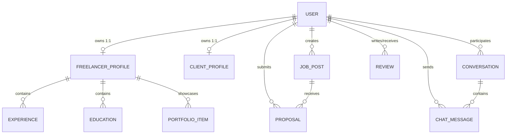

*This project has been created as part of the 42 curriculum by <arajma>, <aysadeq>, <lazmoud>, <omorakwant>, <zbakour>.*

# Skilio — Freelancer Marketplace Platform

[](https://skilio.works)
[](LICENSE)

Skilio is a full-stack, production-grade freelancer marketplace connecting independent professionals with clients. Built as the final capstone project (`ft_transcendence`) for the 42 Common Core curriculum, Skilio provides a complete end-to-end platform with dual-role accounts, real-time messaging, secure cloud infrastructure, and automated disaster recovery.

- **Live Production Application:** [https://skilio.works](https://skilio.works)
- **Live System Telemetry:** [https://grafana.skilio.works](https://grafana.skilio.works)

---

## Table of Contents
1. [Description](#1-description)
2. [Instructions & Quick Start](#2-instructions--quick-start)
3. [Team Information](#3-team-information)
4. [Project Management](#4-project-management)
5. [Technical Stack](#5-technical-stack)
6. [Database Schema](#6-database-schema)
7. [Features List](#7-features-list)
8. [42 Evaluation Modules](#8-42-evaluation-modules)
9. [Individual Contributions](#9-individual-contributions)
10. [Resources & AI Usage Disclosure](#10-resources--ai-usage-disclosure)
11. [Known Limitations & Roadmap](#11-known-limitations--roadmap)
12. [License](#12-license)

---

## 1. Description

### Project Goal & Overview
Finding and hiring freelance talent often suffers from fragmented tools—clients and freelancers switch between job boards, messaging apps, and external storage. Skilio solves this by unifying the entire freelance lifecycle into a single platform:
1. **Dual-Role Identity:** A single login allows users to switch between Client and Freelancer roles on demand, with automatic profile generation and role-specific navigation.
2. **Real-Time Communication:** Full-duplex messaging with typing indicators, read receipts, and multi-device synchronization via WebSockets and Redis.
3. **End-to-End Workflow:** Clients post jobs, freelancers submit bids with cover letters, contracts are negotiated in real time, and verified reviews establish public trust.
4. **Cloud-Native & Production-Ready:** Deployed on AWS EC2 behind a Traefik 3.6 TLS reverse proxy, automated with 3-tier GitHub Actions CI/CD, daily database backups, and sub-60s disaster recovery drills.

### Key Capabilities at a Glance
- **One-Click Workspace Switching:** Instant toggle between hiring and working under one identity.
- **Live Messaging:** WebSocket chat engine backed by Redis Pub/Sub with automatic in-memory fallback.
- **Faceted Search:** Search and filter freelancers by rate, skills, availability, and ratings.
- **Job & Proposal Engine:** Post fixed or hourly contracts, review applicant bids, and track hiring status.
- **Cloud Media Pipeline:** Secure uploads for avatars, portfolio items, and PDF resumes hosted on Cloudinary.
- **Observability & Status:** Public real-time diagnostic page (`/status`), Prometheus scraping, and Grafana telemetry.

---

## 2. Instructions & Quick Start

### Prerequisites
- [Docker Engine](https://docs.docker.com/engine/install/) (`>= 24.0`) and Docker Compose (`v2`)
- [Make](https://www.gnu.org/software/make/) (standard build automation tool)
- Modern web browser (Google Chrome stable recommended for evaluation)

### Step-by-Step Execution (Single-Command)

1. **Clone the repository:**
   ```bash
   git clone https://github.com/Moody-0x01/Freelancer.git
   cd Freelancer
   ```

2. **Configure environment secrets:**
   ```bash
   cp .env.example .env
   ```
   *(The default development variables in `.env.example` work out of the box for local testing).*

3. **Start the complete stack:**
   ```bash
   make up
   ```
   *This single command builds and starts all containers: Traefik, PostgreSQL, Redis, FastAPI, React SPA, Prometheus, Grafana, cAdvisor, postgres-exporter, Mailpit, and the backup daemon.*

4. **Initialize database schema & superuser:**
   ```bash
   docker compose run --rm backend bash scripts/prestart.sh
   ```

5. **(Optional) Populate mock marketplace data:**
   ```bash
   make seed
   ```

### Service Access URLs

| Service | Local URL | Description |
| :--- | :--- | :--- |
| **Skilio Web Application** | [http://localhost:8000](http://localhost:8000) | Full-stack application (FastAPI + React bundle) |
| **Interactive API Docs** | [http://localhost:8000/docs](http://localhost:8000/docs) | Swagger UI for exploring backend endpoints |
| **Public Status Page** | [http://localhost:8000/status](http://localhost:8000/status) | Real-time health diagnostic badges |
| **Grafana Monitoring** | [http://localhost:3000](http://localhost:3000) | Live telemetry dashboards (User: `admin` / `.env` password) |
| **Prometheus TSDB** | [http://localhost:9090](http://localhost:9090) | Scrape targets and alerting rules engine |
| **Mailpit Sandbox** | [http://localhost:8025](http://localhost:8025) | Local SMTP mailbox for password reset emails |
| **Traefik Dashboard** | [http://localhost:8090](http://localhost:8090) | Reverse proxy routing rules and ingress status |

### Testing & Teardown Commands
```bash
make test          # Run full backend pytest suite with code coverage
make dr-test       # Run automated disaster recovery verification drill (< 5s)
make down          # Stop all containers safely
make clean         # Stop containers and remove volumes (clean restart)
```

---

## 3. Team Information

The development team consists of 5 members with clearly separated leadership and technical ownership:

| 42 Login | Full Name | Assigned Role(s) | Primary Responsibilities |
| :--- | :--- | :--- | :--- |
| **`<aysadeq>`** | Ayman Sadik | **DevOps Lead / Infra Architect** | AWS EC2 cloud setup, Docker Compose multi-stage files, Traefik TLS proxy, GitHub Actions CI/CD, backup daemon & disaster recovery drill, Prometheus/Grafana observability. |
| **`<arajma>`** | Amine Rajma | **Backend Lead / Security Lead** | FastAPI REST endpoints, SQLModel database models, Alembic migrations, JWT/Argon2 security, Google & LinkedIn OAuth 2.0 social login, input validation. |
| **`<lazmoud>`** | Lahoucine Azmoud | **Full-Stack Developer / Real-Time Lead** | Bidirectional WebSocket server, Redis Pub/Sub event bus, chat frontend UI, typing indicators, proposal submission and negotiation workflows. |
| **`<omorakwant>`**| Osama Dahriz | **Frontend Developer / QA** | Product backlog organization, landing page, rating and review user journeys, cross-browser QA on Google Chrome. |
| **`<zbakour>`** | Zakaria Bakour | **Frontend Lead / UI-UX Lead** | React 19 architecture, Tailwind CSS v4 design system, responsive navigation, Talent Directory, job post management, theme switcher (dark/light). |

---

## 4. Project Management

The team applied an **Agile Scrum/Kanban workflow** tailored to the 42 project timeline:
- **Sprint Organization:** Development was divided into 2-week iterations:
  1. *Sprint 1:* Foundation, Docker Compose setup, database schema, CI pipeline.
  2. *Sprint 2:* User authentication, OAuth, profile management, and CRUD APIs.
  3. *Sprint 3:* Real-time WebSocket chat, Redis event bus, and proposal engine.
  4. *Sprint 4:* Frontend layout, talent discovery, responsive styling, and accessibility.
  5. *Sprint 5:* AWS cloud deployment, Let's Encrypt TLS, backups, and Prometheus monitoring.
- **Task Tracking:** We used **GitHub Projects & Issues** with a structured Kanban board (`Backlog` $\rightarrow$ `Ready for Dev` $\rightarrow$ `In Progress` $\rightarrow$ `PR Review` $\rightarrow$ `Done`). Every feature was developed on its own branch and linked to an issue.
- **Communication:**
  - **Discord:** Daily asynchronous standups, dedicated technical channels (`#backend`, `#frontend`, `#devops`), and screen-share debugging.
  - **In-Person Syncs:** Weekly architectural whiteboarding and integration testing at the 42 campus.
- **Code Review & Git Flow:** Protected `master` branch. All Pull Requests required passing the 3-tier automated CI gate before merging.

---

## 5. Technical Stack

| Layer | Technologies | Justification & Purpose |
| :--- | :--- | :--- |
| **Frontend** | React 19, TypeScript 6, Vite 8, Tailwind CSS v4, TanStack Router & Query | Modern component architecture, type safety, instant client-side routing, optimistic caching, and fast SWC builds. |
| **Backend** | Python 3.14, FastAPI, SQLModel, Alembic, Pydantic v2, PyJWT, Pwdlib | Asynchronous high concurrency, automatic OpenAPI schemas, type-safe validation with Rust speed, and smooth migrations. |
| **Database** | PostgreSQL 18 (`psycopg 3`) | ACID transactions prevent double-bidding or booking conflicts; native JSONB stores dynamic skill arrays. |
| **Cache & Bus** | Redis 8 (`redis.asyncio`) | In-memory message broker for real-time WebSocket pub/sub across multi-user sessions. |
| **Cloud Storage** | Cloudinary SDK | Cloud media pipeline for secure user avatars, portfolio media, and streamed PDF resumes. |
| **Ingress & Proxy** | Traefik 3.6 | Dynamic Docker socket discovery, automated Let's Encrypt TLS 1.3 certificates, and HTTP 308 redirects. |
| **Cloud Hosting** | AWS EC2 (`t3.small`), Ubuntu 24.04, 2GB Swap | Dedicated production cloud server with static Elastic IP and memory buffer preventing OOM crashes. |
| **Observability** | Prometheus 2.54, Grafana 11.2, cAdvisor, postgres-exporter | Metrics pull model, Dashboards-as-Code in "Skilio" folder, and automated threshold alerts. |

### Why PostgreSQL was chosen over NoSQL:
Marketplaces are fundamentally relational. A user owns profiles, a client creates jobs, a freelancer submits proposals linked to jobs, and clients write reviews linked to completed contracts. PostgreSQL ensures strict relational integrity with foreign keys and cascading deletes, preventing orphan records or corrupted application state.

---

## 6. Database Schema

The relational database consists of 19 normalized tables managed through SQLModel and Alembic migrations.

### Core Entity-Relationship Diagram



### Key Entities & Relations
- **`user`:** Core authentication record (email, hashed password, `active_role`, OAuth provider IDs).
- **`freelancer_profile` / `client_profile`:** Profiles created automatically when a user switches roles.
- **`job_post` & `proposal`:** Stores job title, category, budget, status (`open`, `in_progress`, `closed`), and linked proposals with cover letter and bid price.
- **`conversation` & `chat_message`:** Threaded real-time chat between participants with delivery timestamps and read receipts.
- **`review`:** 1-to-5 star ratings with composite unique constraints preventing duplicate reviews per contract.

---

## 7. Features List

| Feature Domain | Feature Name | Description | Key Tech / Endpoint | Owner |
| :--- | :--- | :--- | :--- | :---: |
| **Authentication** | Social OAuth 2.0 | One-click login with Google OAuth 2.0 and LinkedIn OIDC. | `GET /login/google`, `GET /login/linkedin` | `<arajma>` |
| **Authentication** | Password Security | Argon2/Bcrypt password hashing with token-based email reset. | `POST /login/access-token`, `POST /password-recovery` | `<arajma>` |
| **Identity** | Dual-Role Switching | Toggle between Client and Freelancer workspace in real time. | `POST /users/me/switch-role` | `<arajma>`, `<omorakwant>` |
| **Freelancer** | Profile & Portfolio | Showcase bio, skills, hourly rate, work history, and portfolio items. | `GET /profiles/me`, `POST /profiles/me/portfolio` | `<zbakour>`, `<omorakwant>` |
| **Freelancer** | Resume Upload | Secure PDF resume upload and inline browser preview via Cloudinary. | `POST /profiles/resume` | `<arajma>`, `<zbakour>` |
| **Client** | Job Posting Lifecycle | Post, edit, and close fixed or hourly jobs with required skills. | `POST /jobs/`, `PUT /jobs/{id}` | `<zbakour>` |
| **Talent Search** | Faceted Directory | Search talent by keywords, filter by category, rate, and availability. | `GET /profiles/` | `<zbakour>`, `<omorakwant>` |
| **Proposals** | Bidding Engine | Freelancers submit bids with cover letters; clients accept or reject. | `POST /proposals/`, `PUT /proposals/{id}/status` | `<lazmoud>` |
| **Messaging** | Live WebSocket Chat | Real-time chat with typing indicators, read receipts, and Redis pub/sub. | `WS /api/v1/chat/ws` | `<lazmoud>` |
| **Feedback** | Reviews & Ratings | Clients submit 1-5 star ratings that calculate freelancer public score. | `POST /reviews/`, `GET /reviews/freelancer/{id}` | `<zbakour>` |
| **DevOps** | Zero-Touch CI/CD | 3-tier GitHub Actions validation and zero-downtime rolling container swap. | `.github/workflows/ci-cd.yml` | `<aysadeq>` |
| **DevOps** | Automated DB Backups | Daily cron `.sql.gz` dump daemon with sub-60s disaster recovery drill. | `devops/backup/`, `make dr-test` | `<aysadeq>` |
| **DevOps** | Observability Suite | Prometheus pull metrics, 3 custom Grafana dashboards, threshold alerts. | `devops/monitoring/`, Grafana UI | `<aysadeq>` |
| **DevOps** | Public Status Page | Live diagnostic page probing database, Redis, and disk space. | `/api/v1/health`, `/status` UI | `<aysadeq>` |

---

## 8. 42 Evaluation Modules

We selected **10 modules** totaling **17 points** (exceeding the 14-point minimum requirement):

| Module ID | Classification | Module Description | Points | Owner | Documentation Link |
| :--- | :---: | :--- | :---: | :--- | :--- |
| **IV.1** | **Web (Major)** | Backend Framework (FastAPI) | **2 Pts** | `<arajma>` | [Section 5: Tech Stack](#5-technical-stack) • [docs/architecture.md](docs/architecture.md) |
| **IV.1** | **Web (Major)** | Frontend Framework (React 19) | **2 Pts** | `<omorakwant>` | [Section 5: Tech Stack](#5-technical-stack) • [docs/architecture.md](docs/architecture.md) |
| **IV.1** | **Web (Minor)** | Database System (PostgreSQL 18) | **1 Pt** | `<arajma>` | [Section 6: Database Schema](#6-database-schema) • [docs/architecture.md](docs/architecture.md) |
| **IV.2** | **User (Major)** | User Management & Dual-Role Switching | **2 Pts** | `<arajma>`, `<omorakwant>` | [Section 7: Features List](#7-features-list) |
| **IV.2** | **User (Major)** | Remote Authentication (Google & LinkedIn OAuth) | **2 Pts** | `<arajma>` | [Section 7: Features List](#7-features-list) |
| **IV.4** | **AI/Real-Time (Major)**| Live Real-Time Chat (WebSockets & Redis) | **2 Pts** | `<lazmoud>` | [Section 7: Features List](#7-features-list) • [docs/architecture.md](docs/architecture.md) |
| **IV.7** | **DevOps (Major)** | Observability Suite (Prometheus & Grafana) | **2 Pts** | `<aysadeq>` | [docs/devops/monitoring.md](docs/devops/monitoring.md) |
| **IV.7** | **DevOps (Minor)** | Health Diagnostics, Status Page & Disaster Recovery | **1 Pt** | `<aysadeq>` | [docs/devops/backup.md](docs/devops/backup.md) |
| **IV.10** | **Choice (Major)** | Production Cloud Deployment & Zero-Touch CI/CD | **2 Pts** | `<aysadeq>` | [docs/devops/deployment.md](docs/devops/deployment.md) |
| **IV.10** | **Choice (Minor)** | Cloud Media & Asset Storage (Cloudinary) | **1 Pt** | `<zbakour>`, `<arajma>` | [Section 7: Features List](#7-features-list) |

**Total Points Claimed:** 7 Major (14 Pts) + 3 Minor (3 Pts) = **17 Points**

### Mandatory Justification for Module of Choice (IV.10 Major — Cloud Deployment & CI/CD)
According to the 42 subject (`en.subject.pdf`, page 20), custom Modules of Choice must justify four specific criteria:

1. **Why did you choose this module?**  
   We wanted Skilio to be a real, accessible SaaS on the internet (`https://skilio.works`) rather than an app that only runs locally on `localhost`.
2. **What technical challenges does it address?**  
   Provisioning and securing an AWS EC2 cloud instance, configuring dynamic Let's Encrypt TLS 1.3 certificates via Traefik, building an automated 3-tier GitHub Actions testing gate (lint, pytest, Docker build), and orchestrating zero-downtime container swaps over SSH `rsync` within a tight 2GB RAM budget.
3. **How does it add value to the project?**  
   It eliminates the *"it works on my machine"* problem. Every code change is verified automatically, and commits to `master` deploy to production in under 2 minutes without user downtime.
4. **Why does it deserve Major module status (2 Points)?**  
   It combines the three core pillars of modern production engineering: Infrastructure-as-a-Service (AWS), Ingress & TLS automation (Traefik), and Automated Continuous Delivery (GitHub Actions).

---

## 9. Individual Contributions

Each team member took full ownership of specific technical domains and solved real engineering challenges:

- **`<aysadeq>` (DevOps Lead):**  
  *Contributions:* Designed AWS EC2 server architecture, Traefik reverse proxy with Let's Encrypt SSL, GitHub Actions CI/CD pipeline, automated PostgreSQL backup daemon, sandbox disaster recovery drill, and Prometheus/Grafana observability suite.  
  *Challenge Solved:* Frontend builds spiked memory usage on AWS, causing Linux kernel Out-Of-Memory crashes (Exit Code 137). Solved by creating an automated 2GB swap file with `vm.swappiness=10`, giving the compiler a safety buffer while keeping physical RAM priority for active services.

- **`<arajma>` (Backend Lead):**  
  *Contributions:* Architected FastAPI backend, SQLModel models, Alembic migrations, JWT token generation, Argon2/Bcrypt password hashing, Google & LinkedIn OAuth 2.0 social login, and comprehensive input validation.  
  *Challenge Solved:* Race conditions during user role-switching created duplicate profile rows. Solved by wrapping role switching inside atomic database transactions that query or provision profiles safely.

- **`<lazmoud>` (Real-Time Systems Lead):**  
  *Contributions:* Built the bidirectional WebSocket chat server (`/api/v1/chat/ws`), Redis Pub/Sub event dispatcher, client-side chat UI, live typing indicators, and proposals submission workflow.  
  *Challenge Solved:* Users with multiple browser tabs were missing messages in background tabs. Solved by implementing user-centric connection pooling that broadcasts incoming WebSocket frames across all active sessions belonging to the same user.

- **`<omorakwant>` (Frontend Developer / QA):**  
  *Contributions:* Contributed to product requirements, user flow design, responsive landing page implementation, and conducted cross-browser QA on Google Chrome to ensure zero console errors.  
  *Challenge Solved:* Solved UI alignment and layout shifts on small mobile viewports by restructuring flex/grid layouts with mobile-first breakpoints.

- **`<zbakour>` (Frontend Lead / UI-UX Lead):**  
  *Contributions:* Built the React 19 Single-Page Application, configured Vite with SWC, implemented Tailwind CSS v4 theming, created the Talent Directory with faceted search, client job management views, and review system.  
  *Challenge Solved:* Upgrading to Tailwind CSS v4 introduced breaking changes to theme configuration. Solved by migrating color tokens into standard CSS custom properties compatible with shadcn/ui and Radix primitives.

---

## 10. Resources & AI Usage Disclosure

### References Consulted
- **FastAPI Documentation:** [https://fastapi.tiangolo.com/](https://fastapi.tiangolo.com/) (Async lifespan, dependency injection)
- **React 19 Documentation:** [https://react.dev/](https://react.dev/) (Hooks, client components)
- **SQLModel Documentation:** [https://sqlmodel.tiangolo.com/](https://sqlmodel.tiangolo.com/) (SQLAlchemy 2.0 async integration)
- **PostgreSQL 18 Manual:** [https://www.postgresql.org/docs/](https://www.postgresql.org/docs/) (ACID constraints, JSONB indexing)
- **Traefik Proxy 3.6 Guide:** [https://doc.traefik.io/traefik/](https://doc.traefik.io/traefik/) (Docker dynamic ingress, ACME TLS)
- **Prometheus & Grafana:** [https://prometheus.io/docs/](https://prometheus.io/docs/) and [https://grafana.com/docs/](https://grafana.com/docs/)

### AI Usage Disclosure
In accordance with 42 academic honesty standards (Chapter I and Chapter VI of the subject), AI tools were used responsibly as developer aids:
- **Tools Used:** Google Antigravity / Gemini, Claude, GitHub Copilot.
- **Where AI was used:** Drafting repetitive boilerplate test fixtures (`tests/`), generating initial Tailwind component structures, exploring syntax examples for Redis async Pub/Sub, and structuring documentation outlines.
- **Where AI was NOT used:** System architecture decisions, business logic rules, dual-role identity modeling, AWS server configuration, and peer evaluation defense preparation.
- **Human Verification:** All generated code was manually inspected, modified, and validated through our automated CI testing gates (Pytest, TypeScript type checking, and Docker smoke tests).

---

## 11. Known Limitations & Roadmap

- **Redis Standalone Mode:** Redis operates as a single container instance rather than a multi-node cluster. If Redis goes offline, an automatic in-memory fallback handles single-instance WebSockets gracefully.
- **Local Mail Sandbox:** In local development, outgoing emails are captured by the Mailpit sandbox (`:8025`) rather than delivering to external mail servers.
- **Media Upload Limits:** Cloudinary file uploads are constrained to 5MB for images and 10MB for PDF resumes to maintain fast load times and comply with free-tier bandwidth limits.
- **Future Roadmap:** Planned features include Stripe Connect escrow payments, WebRTC video calling for interviews, and vector search (`pgvector`) for smart job-talent matching.

---

## 12. License

This project is licensed under the terms of the **MIT License**. See the [LICENSE](LICENSE) file for complete details.
