*This project has been created as part of the 42 curriculum by <arajma>, <aysadeq>, <lazmoud>, <omorakwant>, <zbakour>.*

# Skilio — Freelancer Marketplace Platform

[](https://skilio.works)
[](LICENSE)

Skilio is a full-stack, production-grade freelancer marketplace connecting independent professionals with clients. Built as the final capstone project (`ft_transcendence`) for the 42 Common Core curriculum, Skilio provides a complete end-to-end platform with dual-role accounts, real-time messaging, secure cloud infrastructure, and automated disaster recovery.

- **Live Production Application:** [https://skilio.works](https://skilio.works)
- **Live System Telemetry:** [https://grafana.skilio.works](https://grafana.skilio.works)

---

## Table of Contents
1. [Description](#1-description)
2. [Instructions & Quick Start](#2-instructions--quick-start)
3. [Team Information](#3-team-information)
4. [Project Management](#4-project-management)
5. [Technical Stack](#5-technical-stack)
6. [Database Schema](#6-database-schema)
7. [Features List](#7-features-list)
8. [42 Evaluation Modules](#8-42-evaluation-modules)
9. [Individual Contributions](#9-individual-contributions)
10. [Resources & AI Usage Disclosure](#10-resources--ai-usage-disclosure)
11. [Known Limitations & Roadmap](#11-known-limitations--roadmap)
12. [License](#12-license)

---

## 1. Description

### Project Goal & Overview
Finding and hiring freelance talent often suffers from fragmented tools. clients and freelancers switch between job boards, messaging apps, and external storage. Skilio solves this by unifying the entire freelance lifecycle into a single platform:
1. **Dual-Role Identity:** A single login allows users to switch between Client and Freelancer roles on demand, with automatic profile generation and role-specific navigation.
2. **Live Messaging:** Full-duplex messaging with online status, read receipts, and multi-device synchronization via WebSockets and Redis.
3. **End-to-End Workflow:** Clients post jobs, freelancers submit bids with cover letters, contracts are negotiated in real time, and verified reviews establish public trust.
4. **Observability & Status:** Public real-time diagnostic page (`/status`), Prometheus scraping, and Grafana telemetry.
5. **Cloud-Native & Production-Ready:** Deployed on AWS EC2 behind a Traefik 3.6 TLS reverse proxy, automated with 3-tier GitHub Actions CI/CD, daily database backups, and sub-60s disaster recovery drills.

---

## 2. Instructions & Quick Start

### Prerequisites
- [Docker Engine](https://docs.docker.com/engine/install/) (`>= 24.0`) and Docker Compose (`v2`)
- [Make](https://www.gnu.org/software/make/) (standard build automation tool)
- Modern web browser (Google Chrome stable recommended for evaluation)
- Note that everything else required (React, Python, Typescript...) is installed inside the containers.

### Step-by-Step Execution

1. **Clone the repository:**
   ```bash
   git clone git@github.com:Skilio-org/Skilio.git
   cd Skilio
   ```

2. **Configure environment secrets:**
   ```bash
   cp .env.example .env
   ```
   *(The default development variables in `.env.example` work out of the box for local testing).*

3. **Start the complete stack:**
   ```bash
   make up
   ```
   *This single command builds and starts all containers: Traefik, PostgreSQL, Redis, FastAPI, React SPA, Prometheus, Grafana, cAdvisor, postgres-exporter, Mailpit, and the backup daemon.*

4. **Initialize database schema & superuser:**
   ```bash
   docker compose run --rm backend bash scripts/prestart.sh
   ```

5. **(Optional) Populate mock marketplace data:**
   ```bash
   make seed
   ```

### Service Access URLs

| Service | Local URL | Description |
| :--- | :--- | :--- |
| **Skilio Web Application** | [https://localhost:8443](https://localhost:8443) (or `:8080`) | Full-stack application via Traefik HTTPS |
| **Interactive API Docs** | [https://localhost:8443/docs](https://localhost:8443/docs) | Swagger UI for exploring backend endpoints |
| **Public Status Page** | [https://localhost:8443/status](https://localhost:8443/status) | Real-time health diagnostic badges |
| **Grafana Monitoring** | [http://localhost:3000](http://localhost:3000) | Live telemetry dashboards (User: `admin` / `.env` password) |
| **Prometheus TSDB** | [http://localhost:9090](http://localhost:9090) | Scrape targets and alerting rules engine |
| **Mailpit Sandbox** | [http://localhost:8025](http://localhost:8025) | Local SMTP mailbox for password reset emails |
| **Traefik Dashboard** | [http://localhost:8090](http://localhost:8090) | Reverse proxy routing rules and ingress status |

### Testing & Teardown Commands
```bash
make test          # Run full backend pytest suite with code coverage
make dr-test       # Run automated disaster recovery verification drill (< 5s)
make down          # Stop all containers safely
make clean         # Stop containers and remove volumes (clean restart)
```

---

## 3. Team Information

The development team consists of 5 members with clearly separated leadership and technical ownership:

- **`Product Owner`** - *(Amine Rajma)* : Maintained the product backlog, decided on features and priorities, validated completed work, and handled internal communication between team members.
- **`Project Manager`** - *(Ayman Sadik)*: Coordinates the team by running meetings and planning sessions, tracking progress and deadlines, keeping communication clear, and resolving risks and blockers.
- **`Technical Lead`** *(Lahoucine Azmoud)*: Defines the technical architecture, chooses the tech stack, maintains code quality and best practices, and reviews critical code changes.
- **`Developers`** *(Osama Dahriz, Zakaria Bakour, and all the others)*: Builds and tests assigned features and modules, participates in code reviews, and documents the work.

**Note:** more details about individual contributions and technical roles can be found in [section 9](#9-individual-contributions).

---

## 4. Project Management

The team used a straightforward and collaborative project management approach centered on domain ownership and direct communication:

- **Task Organization & Distribution:**
  - Work was divided by technical domain based on each member's core focus (DevOps, Backend, Real-Time Systems, Frontend UI, and QA).
  - Tasks, priorities, and feature requirements were discussed and agreed upon during team meetings.

- **Discord Server:**
  - All project management and day-to-day coordination took place on a dedicated team Discord server.
  - **Issues and Tasks channels:** Used for falagging issues and bugs, and then turn them into tasks tickets for the team member responsible of the domain.
  - **Meetings and Organization:** Organized into dedicated channels for meetings, task updates, and general communication.

- **Meetings & In-Person Syncs:**
  - Regular online check-ins on Discord to review completed work, resolve blockers, and plan upcoming tasks.
  - In-person working sessions in the meeting rooms on campus for architectural discussions, whiteboarding, and integration testing.

---

## 5. Technical Stack

| Layer | Technologies | Justification & Purpose |
| :--- | :--- | :--- |
| **Frontend** | React 19, TypeScript 6, Vite 8, Tailwind CSS v4, TanStack Router & Query | Modern component architecture, type safety, instant client-side routing, optimistic caching, and fast SWC builds. |
| **Backend** | Python 3.14, FastAPI, SQLModel, Alembic, Pydantic v2 | Asynchronous high concurrency, automatic OpenAPI schemas, type-safe validation, and smooth migrations. |
| **Database** | PostgreSQL 18 | ACID transactions prevent double-bidding or booking conflicts; native JSONB stores dynamic skill arrays. |
| **Cache & Bus** | Redis 8 | In-memory message broker for real-time WebSocket pub/sub across multi-user sessions. |
| **Cloud Storage** | Cloudinary SDK | Dedicated media storage and CDN delivery for user avatars, portfolio assets, and streamed PDF resumes. |
| **Ingress & Proxy** | Traefik 3.6 | Dynamic Docker socket discovery, automated Let's Encrypt TLS 1.3 certificates, and HTTP 308 redirects. |
| **Cloud Hosting** | AWS EC2 (`t3.small`), Ubuntu 24.04, 2GB Swap | Dedicated production cloud server with static Elastic IP and memory buffer preventing OOM crashes. |
| **Observability** | Prometheus 2.54, Grafana 11.2, cAdvisor, postgres-exporter | Metrics pull model, Dashboards-as-Code in "Skilio" folder, and automated threshold alerts. |

### Why PostgreSQL was chosen over NoSQL:
Marketplaces are fundamentally relational. A user owns profiles, a client creates jobs, a freelancer submits proposals linked to jobs, and clients write reviews linked to completed contracts. PostgreSQL ensures strict relational integrity with foreign keys and cascading deletes, preventing orphan records or corrupted application state.

---

## 6. Database Schema

The relational database consists of 18 normalized tables managed through SQLModel and Alembic migrations.

### Core Entity-Relationship Diagram

```mermaid
erDiagram
    USER ||--o| FREELANCER_PROFILE : "owns (1:1)"
    USER ||--o| CLIENT_PROFILE : "owns (1:1)"
    USER ||--o{ JOB_POST : "posts as client (1:N)"
    USER ||--o{ PROPOSAL : "submits as freelancer (1:N)"
    USER ||--o{ CONVERSATION : "participates (client or freelancer)"
    USER ||--o{ CHAT_MESSAGE : "sends (1:N)"
    USER ||--o{ MEDIA : "uploads (1:N)"
    USER ||--o{ REVIEW : "authors as client (1:N)"
    USER ||--o{ LIKED_FREELANCER : "favorites as client (1:N)"
    USER ||--o{ SAVED_JOB : "bookmarks as freelancer (1:N)"
    USER ||--o{ RECENT_SEARCH : "records queries (1:N)"
    USER ||--o{ CONNECTION : "participates (sender or receiver)"
    USER ||--o{ NOTIFICATION : "receives (1:N)"
    USER ||--o{ PASSWORD_RESET_TOKEN : "requests via email (1:N)"

    FREELANCER_PROFILE ||--o{ EXPERIENCE : "has (1:N)"
    FREELANCER_PROFILE ||--o{ EDUCATION : "has (1:N)"
    FREELANCER_PROFILE ||--o{ PORTFOLIO_ITEM : "showcases (1:N)"
    FREELANCER_PROFILE ||--o{ MEDIA : "portfolio attachments (1:N)"
    FREELANCER_PROFILE ||--o{ REVIEW : "receives (1:N)"
    FREELANCER_PROFILE ||--o{ LIKED_FREELANCER : "targeted by (1:N)"

    JOB_POST ||--o{ PROPOSAL : "receives (1:N)"
    JOB_POST ||--o{ SAVED_JOB : "saved by (1:N)"
    JOB_POST ||--o{ CONNECTION : "referenced in (0..1:N)"
    JOB_POST ||--o{ NOTIFICATION : "target for notification"

    CONVERSATION ||--o{ CHAT_MESSAGE : "contains (1:N)"
    CHAT_MESSAGE ||--o| MEDIA : "optional attachment (0..1:1)"
    CHAT_MESSAGE ||--o{ NOTIFICATION : "target for notification"

    PROPOSAL ||--o{ NOTIFICATION : "target for notification"
    CONNECTION ||--o{ NOTIFICATION : "target for notification"
    REVIEW ||--o{ NOTIFICATION : "target for notification"

    USER {
        uuid id PK
        string email UK "indexed, max 255"
        string hashed_password
        string full_name "max 100"
        string active_role "client | freelancer"
        boolean is_active "default true"
        boolean is_superuser "default false"
        boolean is_email_verified "default false"
        string avatar_url "max 2000, fallback default"
        string google_id "max 255"
        string linkedin_id "max 255"
        string refresh_token
        timestamptz created_at
    }

    PASSWORD_RESET_TOKEN {
        uuid id PK
        string token_hash UK "indexed, 64-char sha256"
        string email "indexed, max 255"
        timestamptz expires_at
        timestamptz used_at
    }

    FREELANCER_PROFILE {
        uuid id PK
        uuid user_id FK "UK (1:1 with user)"
        string title "max 100"
        string bio "max 3000 chars"
        float hourly_rate "10 - 5000 DH"
        int years_of_experience
        boolean is_available "default true"
        string availability "max 100"
        string hours "max 100"
        string category "indexed, max 100"
        boolean finished "default false"
        string location "max 255"
        string timezone "max 100"
        string languages "max 500"
        string avatar_url "max 2000, fallback default"
        string resume_url "max 2048, Cloudinary PDF"
        string resume_public_id "max 255"
        json skills "JSON array of skill tags"
        timestamptz created_at
        timestamptz updated_at
    }

    CLIENT_PROFILE {
        uuid id PK
        uuid user_id FK "UK (1:1 with user)"
        string company "max 100"
        string company_role "max 100"
        string company_website "max 2048, https"
        string company_size "solo | 2-10 | 11-50 | 51-200 | 201-plus"
        string location "max 255"
        string description "max 5000 chars"
        string avatar_url "max 2000, fallback default"
        timestamptz created_at
        timestamptz updated_at
    }

    JOB_POST {
        uuid id PK
        uuid client_id FK "user.id"
        string title "max 100"
        string description "max 5000 chars, includes experience level"
        string budget_type "fixed | hourly"
        float budget "DH"
        string location "max 255"
        string category "indexed, max 100"
        string status "draft | open | closed"
        json skills "JSON array of skill tags"
        timestamptz created_at
        timestamptz updated_at
    }

    PROPOSAL {
        uuid id PK
        uuid job_post_id FK "jobpost.id"
        uuid freelancer_id FK "user.id"
        string status "draft | pending | accepted | rejected"
        string cover_letter "max 3000 chars"
        timestamptz created_at
        timestamptz updated_at
    }

    REVIEW {
        uuid id PK
        uuid client_id FK "user.id"
        uuid freelancer_id FK "freelancerprofile.id"
        int rating "1 - 5 stars"
        string comment "max 400 chars"
        timestamptz created_at
        timestamptz updated_at
    }

    LIKED_FREELANCER {
        uuid id PK
        uuid client_id FK "user.id"
        uuid freelancer_id FK "freelancerprofile.id"
        timestamptz created_at
    }

    SAVED_JOB {
        uuid id PK
        uuid freelancer_id FK "user.id"
        uuid job_post_id FK "jobpost.id"
        timestamptz created_at
    }

    CONVERSATION {
        uuid id PK
        uuid client_id FK "user.id"
        uuid freelancer_id FK "user.id"
        uuid creator_id FK "user.id"
        int unread_count "default 0"
        timestamptz created_at
        timestamptz updated_at
    }

    CHAT_MESSAGE {
        uuid id PK
        uuid conversation_id FK "conversation.id"
        uuid sender_id FK "user.id"
        uuid attachment_id FK "media.id, SET NULL"
        string content "max 5000 chars"
        boolean is_read "default false"
        timestamptz created_at
    }

    MEDIA {
        uuid id PK
        uuid uploader_id FK "user.id"
        uuid freelancer_profile_id FK "freelancerprofile.id, nullable"
        string title "max 255"
        string description "max 1000"
        string media_type "avatar | resume | portfolio_image | chat_attachment | other"
        string public_id "indexed Cloudinary public ID"
        string url "max 2048"
        string resource_type "default image"
        string format "max 20"
        int bytes
        int width
        int height
        timestamptz created_at
    }

    EXPERIENCE {
        uuid id PK
        uuid freelancer_profile_id FK "freelancerprofile.id"
        string title "max 100"
        string organization "max 100"
        string detail "max 1000 chars"
        string url "max 2048, https"
        timestamptz created_at
        timestamptz updated_at
    }

    EDUCATION {
        uuid id PK
        uuid freelancer_profile_id FK "freelancerprofile.id"
        string institution "max 100"
        string degree "max 100"
        string field_of_study "max 100"
        string start_date "max 50"
        string end_date "max 50"
        string description "max 1000"
        string title "max 100"
        string organization "max 100"
        string detail "max 1000"
        string url "max 2048, https"
        timestamptz created_at
    }

    PORTFOLIO_ITEM {
        uuid id PK
        uuid freelancer_profile_id FK "freelancerprofile.id"
        string title "max 100"
        string description "max 1000"
        string image_url "max 2048"
        string organization "max 100"
        string detail "max 1000"
        string url "max 2048, https"
        timestamptz created_at
        timestamptz updated_at
    }

    RECENT_SEARCH {
        uuid id PK
        uuid user_id FK "user.id, indexed"
        string query "max 255"
        timestamptz created_at
    }

    CONNECTION {
        uuid id PK
        uuid sender_id FK "user.id, indexed"
        uuid receiver_id FK "user.id, indexed"
        uuid client_id FK "user.id, indexed"
        uuid freelancer_id FK "user.id, indexed"
        uuid job_post_id FK "jobpost.id, nullable, indexed"
        string status "indexed: pending | accepted | declined | withdrawn"
        string note "max 300 chars"
        timestamptz created_at
        timestamptz updated_at
        timestamptz responded_at
    }

    NOTIFICATION {
        uuid id PK
        uuid user_id FK "user.id, indexed recipient"
        uuid proposal_id FK "proposal.id, nullable, indexed"
        uuid connection_id FK "connection.id, nullable, indexed"
        uuid review_id FK "review.id, nullable, indexed"
        uuid chat_message_id FK "chatmessage.id, nullable, indexed"
        uuid job_post_id FK "jobpost.id, nullable, indexed"
        string event "indexed: NotificationEvent"
        string title "max 255"
        string content "max 5000 chars"
        boolean is_read "indexed, default false"
        timestamptz created_at
    }
```



### Key Entities & Architecture

- **Identity & Profiles:** Unified `user` with OAuth/JWT auth, 1:1 dual workspaces (`client_profile`, `freelancer_profile`), and credential records (`experience`, `education`, `portfolio_item`, `password_reset_token`).
- **Marketplace & Networking:** Bidding workflow via `job_post` and `proposal`, paired with `connection` networking, bookmarking (`saved_job`, `liked_freelancer`), and verified `review` ratings.
- **Communication & Platform Services:** Threaded live chat via `conversation` and `chat_message`, Cloudinary `media` assets, `recent_search` caching, and event-driven `notification` alerts.

---

## 7. Features List

| Category | Feature | Description | Owner |
| :--- | :--- | :--- | :---: |
| **Authentication & Security** | Social OAuth 2.0 | One-click login with Google OAuth 2.0 and LinkedIn OIDC. | `[Owner]` |
| **Authentication & Security** | Password Security & Recovery | Argon2/Bcrypt password hashing with secure token-based email password reset. | `[Owner]` |
| **Authentication & Security** | Email Verification & Route Guards | Account email verification tracking and JWT-based protected route authorization. | `[Owner]` |
| **Identity & Account** | Dual-Role Workspace Switching | Real-time toggle between Client and Freelancer modes under a single user identity. | `[Owner]` |
| **Identity & Account** | User Settings & Account Management | Self-service profile updating, password management, and account preferences. | `[Owner]` |
| **Freelancer Workspace** | Profile & Credential Showcase | Public showcase with bio, hourly rate, skill tags, experience, education, and portfolio. | `[Owner]` |
| **Freelancer Workspace** | Cloud Resume Management | PDF resume upload to Cloudinary with secure inline browser preview. | `[Owner]` |
| **Freelancer Workspace** | Availability & Hours Settings | Instant availability toggle ("Available now"), working hours, and timezone controls. | `[Owner]` |
| **Client Workspace** | Company Profile Management | Custom company branding with industry role, website, team size, location, and bio. | `[Owner]` |
| **Client Workspace** | Job Posting Lifecycle | Draft, publish, edit, and close fixed or hourly jobs with budget and skill tags. | `[Owner]` |
| **Client Workspace** | Talent Bookmarking | Save and manage favorite freelancer profiles for future project hiring. | `[Owner]` |
| **Search & Discovery** | Faceted Talent Directory | Full-text and fuzzy search via `pg_trgm`, filtered by category, hourly rate, and skills. | `[Owner]` |
| **Search & Discovery** | Marketplace Job Discovery | Browse open jobs by category, budget tier, and keyword, with recent search tracking. | `[Owner]` |
| **Proposals & Bidding** | Proposal Bidding Workflow | Freelancers submit bids with cover letters; clients review, accept, or decline. | `[Owner]` |
| **Networking & Connections** | Direct Professional Connections | Send, accept, decline, or withdraw networking requests with optional project context. | `[Owner]` |
| **Real-Time Communication** | Live WebSocket Chat | Threaded full-duplex messaging powered by Redis Pub/Sub with presence and read receipts. | `[Owner]` |
| **Real-Time Communication** | Chat Media Attachments | Upload and share image or document attachments directly inside conversation threads. | `[Owner]` |
| **Feedback & Reputation** | Verified Reviews & Ratings | Clients submit 1-to-5 star ratings and comments that aggregate into public freelancer scores. | `[Owner]` |
| **Notifications & Alerts** | In-App Notification Center | Event-driven alerts for proposals, messages, connections, reviews, and job updates. | `[Owner]` |
| **DevOps & Reliability** | Public System Status Page | Live diagnostic dashboard probing PostgreSQL, Redis, and disk latency. | `[Owner]` |
| **DevOps & Reliability** | Zero-Touch CI/CD Pipeline | 3-tier GitHub Actions validation running linters, tests, Docker builds, and cloud delivery. | `[Owner]` |
| **DevOps & Reliability** | Automated DB Backups & DR | Daily scheduled compressed PostgreSQL dumps with sub-60s disaster recovery test drills. | `[Owner]` |
| **DevOps & Reliability** | Observability Suite | Prometheus metrics collection, cAdvisor container telemetry, and custom Grafana dashboards. | `[Owner]` |
| **UI / UX Experience** | Dark & Light Theme System | System-aware theme switcher with persistent user preference across sessions. | `[Owner]` |
| **UI / UX Experience** | Responsive Mobile Layout | Mobile-first navigation with adaptive sidebars, quick-search modals, and touch controls. | `[Owner]` |

---

## 8. 42 Evaluation Modules

We selected **10 modules** totaling **17 points** (exceeding the 14-point minimum requirement):

| Module ID | Classification | Module Description | Points | Owner | Documentation Link |
| :--- | :---: | :--- | :---: | :--- | :--- |
| **IV.1** | **Web (Major)** | Backend Framework (FastAPI) | **2 Pts** | `<arajma>` | [Section 5: Tech Stack](#5-technical-stack) • [docs/architecture.md](docs/architecture.md) |
| **IV.1** | **Web (Major)** | Frontend Framework (React 19) | **2 Pts** | `<omorakwant>` | [Section 5: Tech Stack](#5-technical-stack) • [docs/architecture.md](docs/architecture.md) |
| **IV.1** | **Web (Minor)** | Database System (PostgreSQL 18) | **1 Pt** | `<arajma>` | [Section 6: Database Schema](#6-database-schema) • [docs/architecture.md](docs/architecture.md) |
| **IV.2** | **User (Major)** | User Management & Dual-Role Switching | **2 Pts** | `<arajma>`, `<omorakwant>` | [Section 7: Features List](#7-features-list) |
| **IV.2** | **User (Major)** | Remote Authentication (Google & LinkedIn OAuth) | **2 Pts** | `<arajma>` | [Section 7: Features List](#7-features-list) |
| **IV.4** | **AI/Real-Time (Major)**| Live Real-Time Chat (WebSockets & Redis) | **2 Pts** | `<lazmoud>` | [Section 7: Features List](#7-features-list) • [docs/architecture.md](docs/architecture.md) |
| **IV.7** | **DevOps (Major)** | Observability Suite (Prometheus & Grafana) | **2 Pts** | `<aysadeq>` | [docs/devops/monitoring.md](docs/devops/monitoring.md) |
| **IV.7** | **DevOps (Minor)** | Health Diagnostics, Status Page & Disaster Recovery | **1 Pt** | `<aysadeq>` | [docs/devops/backup.md](docs/devops/backup.md) |
| **IV.10** | **Choice (Major)** | Production Cloud Deployment & Zero-Touch CI/CD | **2 Pts** | `<aysadeq>` | [docs/devops/deployment.md](docs/devops/deployment.md) |
| **IV.10** | **Choice (Minor)** | Cloud Media & Asset Storage (Cloudinary) | **1 Pt** | `<zbakour>`, `<arajma>` | [Section 7: Features List](#7-features-list) |

**Total Points Claimed:** 7 Major (14 Pts) + 3 Minor (3 Pts) = **17 Points**

### Mandatory Justification for Module of Choice (IV.10 Major — Cloud Deployment & CI/CD)
According to the 42 subject (`en.subject.pdf`, page 20), custom Modules of Choice must justify four specific criteria:

1. **Why did you choose this module?**  
   We wanted Skilio to be a real, accessible SaaS on the internet (`https://skilio.works`) rather than an app that only runs locally on `localhost`.
2. **What technical challenges does it address?**  
   Provisioning and securing an AWS EC2 cloud instance, configuring dynamic Let's Encrypt TLS 1.3 certificates via Traefik, building an automated 3-tier GitHub Actions testing gate (lint, pytest, Docker build), and orchestrating zero-downtime container swaps over SSH `rsync` within a tight 2GB RAM budget.
3. **How does it add value to the project?**  
   It eliminates the *"it works on my machine"* problem. Every code change is verified automatically, and commits to `master` deploy to production in under 2 minutes without user downtime.
4. **Why does it deserve Major module status (2 Points)?**  
   It combines the three core pillars of modern production engineering: Infrastructure-as-a-Service (AWS), Ingress & TLS automation (Traefik), and Automated Continuous Delivery (GitHub Actions).

---

## 9. Individual Contributions

Each team member took full ownership of specific technical domains and solved real engineering challenges:

- **`<aysadeq>` (DevOps Lead):**  
  *Contributions:* Designed AWS EC2 server architecture, Traefik reverse proxy with Let's Encrypt SSL, GitHub Actions CI/CD pipeline, automated PostgreSQL backup daemon, sandbox disaster recovery drill, and Prometheus/Grafana observability suite.  
  *Challenge Solved:* Frontend builds spiked memory usage on AWS, causing Linux kernel Out-Of-Memory crashes (Exit Code 137). Solved by creating an automated 2GB swap file with `vm.swappiness=10`, giving the compiler a safety buffer while keeping physical RAM priority for active services.

- **`<arajma>` (Backend Lead):**  
  *Contributions:* Architected FastAPI backend, SQLModel models, Alembic migrations, JWT token generation, Argon2/Bcrypt password hashing, Google & LinkedIn OAuth 2.0 social login, and comprehensive input validation.  
  *Challenge Solved:* Race conditions during user role-switching created duplicate profile rows. Solved by wrapping role switching inside atomic database transactions that query or provision profiles safely.

- **`<lazmoud>` (Real-Time Systems Lead):**  
  *Contributions:* Built the bidirectional WebSocket chat server (`/api/v1/chat/ws`), Redis Pub/Sub event dispatcher, client-side chat UI, live typing indicators, and proposals submission workflow.  
  *Challenge Solved:* Users with multiple browser tabs were missing messages in background tabs. Solved by implementing user-centric connection pooling that broadcasts incoming WebSocket frames across all active sessions belonging to the same user.

- **`<omorakwant>` (Frontend Developer / QA):**  
  *Contributions:* Contributed to product requirements, user flow design, responsive landing page implementation, and conducted cross-browser QA on Google Chrome to ensure zero console errors.  
  *Challenge Solved:* Solved UI alignment and layout shifts on small mobile viewports by restructuring flex/grid layouts with mobile-first breakpoints.

- **`<zbakour>` (Frontend Lead / UI-UX Lead):**  
  *Contributions:* Built the React 19 Single-Page Application, configured Vite with SWC, implemented Tailwind CSS v4 theming, created the Talent Directory with faceted search, client job management views, and review system.  
  *Challenge Solved:* Upgrading to Tailwind CSS v4 introduced breaking changes to theme configuration. Solved by migrating color tokens into standard CSS custom properties compatible with shadcn/ui and Radix primitives.

---

## 10. Resources & AI Usage Disclosure

### References Consulted
- **FastAPI Documentation:** [https://fastapi.tiangolo.com/](https://fastapi.tiangolo.com/) (Async lifespan, dependency injection)
- **React 19 Documentation:** [https://react.dev/](https://react.dev/) (Hooks, client components)
- **SQLModel Documentation:** [https://sqlmodel.tiangolo.com/](https://sqlmodel.tiangolo.com/) (SQLAlchemy 2.0 async integration)
- **PostgreSQL 18 Manual:** [https://www.postgresql.org/docs/](https://www.postgresql.org/docs/) (ACID constraints, JSONB indexing)
- **Traefik Proxy 3.6 Guide:** [https://doc.traefik.io/traefik/](https://doc.traefik.io/traefik/) (Docker dynamic ingress, ACME TLS)
- **Prometheus & Grafana:** [https://prometheus.io/docs/](https://prometheus.io/docs/) and [https://grafana.com/docs/](https://grafana.com/docs/)

### AI Usage Disclosure
In accordance with 42 academic honesty standards (Chapter I and Chapter VI of the subject), AI tools were used responsibly as developer aids:
- **Tools Used:** Google Antigravity / Gemini, Claude, GitHub Copilot.
- **Where AI was used:** Drafting repetitive boilerplate test fixtures (`tests/`), generating initial Tailwind component structures, exploring syntax examples for Redis async Pub/Sub, and structuring documentation outlines.
- **Where AI was NOT used:** System architecture decisions, business logic rules, dual-role identity modeling, AWS server configuration, and peer evaluation defense preparation.
- **Human Verification:** All generated code was manually inspected, modified, and validated through our automated CI testing gates (Pytest, TypeScript type checking, and Docker smoke tests).

---

## 12. License

This project is licensed under the terms of the **MIT License**. See the [LICENSE](LICENSE) file for complete details.
