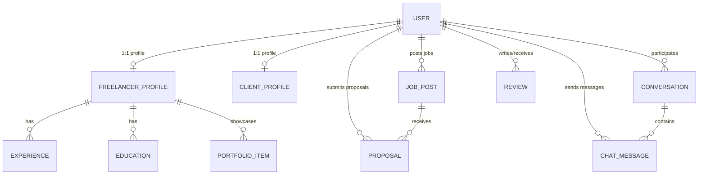

*This project has been created as part of the 42 curriculum by <arajma>, <aysadeq>, <lazmoud>, <omorakwant>, <zbakour>.*

# 🚀 Skilio — Freelancer Marketplace Platform

[](https://skilio.works)
[](https://github.com/Moody-0x01/Freelancer/actions/workflows/test-backend.yml)
[](https://github.com/Moody-0x01/Freelancer/actions/workflows/test-docker-compose.yml)
[](https://www.python.org/)
[](https://fastapi.tiangolo.com)
[](https://react.dev)
[](https://www.typescriptlang.org/)
[](https://www.postgresql.org/)
[](https://redis.io/)
[](https://docs.docker.com/compose/)
[](LICENSE)

---

## 📑 Table of Contents
1. [Description](#-description)
2. [Team Information](#-team-information)
3. [Project Management](#-project-management)
4. [Technical Stack](#-technical-stack)
5. [Database Schema](#-database-schema)
6. [Features List](#-features-list)
7. [42 Evaluation Modules & Point Breakdown](#-42-evaluation-modules--point-breakdown)
8. [Individual Contributions](#-individual-contributions)
9. [Instructions (Compilation, Setup & Execution)](#-instructions-compilation-setup--execution)
10. [Resources & AI Usage Disclosure](#-resources--ai-usage-disclosure)
11. [Known Limitations & Roadmap](#-known-limitations--roadmap)
12. [Documentation Directory Index](#-documentation-directory-index)
13. [License & Credits](#-license--credits)

---

## 📖 Description

> 📝 **What to write in this section:**  
> Provide a clear, compelling elevator pitch for your project.  
> - **Evaluator Expectation:** An evaluator should read this section in 30 seconds and understand: What problem does your project solve? Who are the target users? What makes it technically substantial?  
> - **What to fill in:**  
>   - The official name of your platform (**Skilio**).  
>   - The project goal and core mission (connecting independent professionals with hiring clients).  
>   - A bulleted summary of the 5-7 killer capabilities (dual-role accounts, real-time messaging, faceted discovery, cloud file hosting, disaster recovery).

### Project Name: **Skilio** (Freelancer Marketplace Platform)

**Skilio** is a full-stack, production-grade freelancer marketplace built to connect independent professionals with clients. Developed to fulfill and exceed the requirements of the **42 `ft_transcendence`** project, Skilio delivers an enterprise-level SaaS experience featuring real-time communication, resilient cloud infrastructure, and seamless user experiences.

### Core Goals & Architectural Vision:
- **Unified Dual-Role Ecosystem:** Eliminate multiple logins by allowing users to toggle seamlessly between **Client** and **Freelancer** workspaces under a single identity with on-demand profile provisioning.
- **Distributed Real-Time Engine:** Enable instantaneous messaging, typing presence, and event notifications using WebSockets and Redis Pub/Sub channels with automatic in-memory fallback.
- **End-to-End Freelance Lifecycle:** Support complete project workflows from posting jobs, receiving proposals, bidding with custom cover letters, direct chatting, through to client ratings and testimonials.
- **Production Cloud Architecture & Zero-Downtime:** Deployed live on AWS EC2 behind a Traefik 3.6 TLS reverse proxy, backed by automated 3-tier CI/CD pipelines, automated daily database backups, and sub-60s disaster recovery drills.

### Key Capabilities at a Glance:
- 🔄 **Dynamic Workspace Switching:** One-click role change between Client and Freelancer with dynamic route guarding.
- 💬 **Live WebSocket Messaging:** Full-duplex real-time chat with typing indicators, read receipts, and multi-device synchronization.
- 💼 **Job & Proposal Management:** Post fixed/hourly contracts, submit proposals, negotiate rates, and track application statuses (`pending`, `accepted`, `rejected`).
- 🎯 **Faceted Talent Directory:** Search talent by category, hourly rate, verified ratings, and skill tags.
- ☁️ **Cloudinary Media Pipeline:** Direct-to-cloud asset storage for avatars, portfolio items, and streaming PDF resumes.
- 🔐 **Multi-Provider Authentication:** Google OAuth 2.0 and LinkedIn OIDC social login alongside Argon2/Bcrypt password hashing and JWT access tokens.
- 🛡️ **DevOps & High Availability:** Live telemetry with Prometheus & Grafana, diagnostic status page (`/status`), automated `.sql.gz` backups, and verification drills.

👉 **Deep Dive:** See [docs/architecture.md](docs/architecture.md) for full system topology, sequence diagrams, and lifecycle charts.

---

## 👥 Team Information

> 📝 **What to write in this section:**  
> List every team member mentioned in the header of this README. For each person, specify:  
> - 42 Login, Full Name, and Contact email.  
> - Assigned role(s) (e.g., Product Owner (PO), Project Manager (PM), Tech Lead, Backend Lead, Frontend Lead, DevOps Lead).  
> - A concise 2-sentence summary of their primary responsibilities and areas of ownership.  
> 👉 Complete detailed roles, leadership structure, and RACI matrix are available in: **[docs/team.md](docs/team.md)**.

| 42 Login | Full Name | Assigned Role(s) | Primary Responsibilities |
| :--- | :--- | :--- | :--- |
| **`<aysadeq>`** | [Ayman Sadik] | **DevOps Lead / Infra Architect** | AWS EC2 cloud infrastructure, Docker Compose multi-stage builds, Traefik TLS, CI/CD pipeline, DB Backup Daemon & DR, Prometheus/Grafana monitoring. |
| **`<arajma>`** | [Amine Rajma] | **Backend Lead / Security Lead** | FastAPI REST endpoints, SQLModel relational models, Alembic migrations, JWT/Argon2 security, Google/LinkedIn OAuth 2.0, input validation. |
| **`<lazmoud>`** | [Lahoucine Azmoud] | **Full-Stack Dev / Real-Time Lead**| Bidirectional WebSocket gateway, Redis Pub/Sub distributed event bus, React chat UI, typing indicators, proposals workflow. |
| **`<omorakwant>`**| [Osama Dahriz] | **Frontend Developer** | Product backlog, user stories, landing page, ratings/reviews engine, role route guards. |
| **`<zbakour>`** | [Zakaria Bakour] | **Frontend Lead / UI-UX Lead** | React 19 architecture, Tailwind CSS v4 design system, dark/light theme, responsive navigation, Talent Directory & search filters, Client Job management,  cross-browser QA. |

👉 **Detailed Guide:** Read the full role definitions and RACI matrix in **[docs/team.md](docs/team.md)**.

---

## 📋 Project Management

> 📝 **What to write in this section:**  
> Summarize how your team organized tasks, maintained team discipline, and coordinated deliverables.  
> - **Organization:** Agile/Scrum sprints, daily standup syncs, sprint planning, backlog refinement.  
> - **Tools:** GitHub Issues & Projects (Kanban), Trello, Notion.  
> - **Communication:** Discord server channels, Slack, WhatsApp for urgent alerts, on-campus pair programming.  
> 👉 Complete sprint breakdown, branch rules, and meeting logs are available in: **[docs/project-management.md](docs/project-management.md)** and **[docs/git-workflow.md](docs/git-workflow.md)**.

- **Development Methodology:** Iterative 2-week Agile sprints transitioning from infrastructure & data modeling, through core marketplace workflows, to UI polish and disaster recovery testing.
- **Project Tracking Tools:** **GitHub Projects & Issues** Kanban board (`Backlog` $\rightarrow$ `Ready for Dev` $\rightarrow$ `In Progress` $\rightarrow$ `PR Review` $\rightarrow$ `QA/Done`). Pull requests required explicit issue linking (`Closes #12`).
- **Communication Channels:**
  - **Discord:** Daily asynchronous standups, dedicated technical channels (`#dev-backend`, `#dev-frontend`, `#devops`), and screen-sharing pair programming.
  - **In-Person Syncs:** Weekly architecture review and whiteboarding sessions at the 42 cluster.
  - **WhatsApp:** Urgent alerts for cloud server status or evaluation schedule updates.
- **Git Strategy:** Lightweight GitHub Flow with protected `master` branch. All changes merged via Pull Requests after passing automated 3-tier GitHub Actions CI gates.

👉 **Detailed Guide:** Read our full agile methodology, meeting logs, and sprint retrospectives in **[docs/project-management.md](docs/project-management.md)**.

---

## 🛠️ Technical Stack

> 📝 **What to write in this section:**  
> List your frontend, backend, database, and infrastructure technologies, along with clear architectural justifications.  
> - **Evaluator Expectation:** Be prepared to defend your choices: *"Why PostgreSQL over MongoDB?", "Why FastAPI over Django?", "Why React 19 + Vite over Next.js?"*.  
> 👉 In-depth comparative justifications and trade-off analyses are available in: **[docs/tech-stack.md](docs/tech-stack.md)**.

| Layer | Technologies Used | Key Purpose |
| :--- | :--- | :--- |
| **Frontend** | **React 19 • TypeScript 6 • Vite 8 • Tailwind CSS v4 • TanStack Router & Query • Radix UI • shadcn/ui • Biome** | Type-safe, modular Single-Page Application (SPA) with declarative caching and dynamic theming. |
| **Backend** | **Python 3.14 • FastAPI • SQLModel (SQLAlchemy 2.0 + Pydantic v2) • Alembic • PyJWT • Pwdlib (Argon2 / Bcrypt)** | Asynchronous high-throughput REST and WebSocket API with compiled Rust validation speed. |
| **Database** | **PostgreSQL 18 (`psycopg 3.3`)** | ACID-compliant relational storage ensuring strict integrity across jobs, proposals, and reviews. |
| **Cache & Bus** | **Redis 8.1 (`redis.asyncio`)** | Distributed in-memory Pub/Sub event bus for multi-device real-time WebSocket messaging. |
| **Media / CDN** | **Cloudinary SDK** | Secure cloud storage and streaming delivery for profile avatars, portfolio images, and PDF resumes. |
| **DevOps / Infra**| **Docker Compose • Traefik 3.6 • AWS EC2 • Prometheus • Grafana • Mailpit** | Multi-stage containerization, automated Let's Encrypt TLS 1.3, CI/CD, backups, and live telemetry. |

### Why PostgreSQL was chosen:
- **Relational Integrity & Foreign Keys:** Marketplaces rely on strictly interconnected entities (Users $\rightarrow$ Profiles $\rightarrow$ Jobs $\rightarrow$ Proposals $\rightarrow$ Reviews). Cascading foreign keys prevent orphaned records and corrupted application state.
- **ACID Transaction Guarantees:** Prevents race conditions during simultaneous proposal submissions and contract acceptances.
- **Native JSONB Support:** Stores flexible skill lists and portfolio metadata within structured relational records without losing indexing power.

👉 **Detailed Guide:** Read our comprehensive technical justifications and framework comparisons in **[docs/tech-stack.md](docs/tech-stack.md)**.

---

## 🗄️ Database Schema

> 📝 **What to write in this section:**  
> Present a clear visual diagram (ERD) and description of the relational database structure, listing tables, cardinalities (1:1, 1:N, N:M), foreign keys, and unique constraints.  
> 👉 Full field-level column types, constraint rules, and cascade deletion policies are available in: **[docs/database-schema.md](docs/database-schema.md)**.

### Entity-Relationship Diagram (ERD Summary)



### Key Relational Entities:
- **`user`:** Core authentication identity, role flag (`active_role`), hashed credentials, and OAuth identifiers.
- **`freelancer_profile` & `client_profile`:** 1-to-1 profile extensions automatically provisioned upon role activation.
- **`job_post` & `proposal`:** 1-to-many relationship linking client project specifications with freelancer applications and custom proposed rates.
- **`conversation` & `chat_message`:** Canonical 1-to-1 chat thread between client and freelancer containing timestamped messages and attachments.
- **`review`:** Client testimonials and 1-5 star ratings with composite unique constraints preventing duplicate reviews.

👉 **Detailed Guide:** View the complete database schema, column types, and cascade deletion rules in **[docs/database-schema.md](docs/database-schema.md)**.

---

## ✨ Features List

> 📝 **What to write in this section:**  
> List all implemented features, indicating the responsible team member(s) and a short description of functionality.  
> 👉 Complete feature catalog, user journeys, and test verification notes are available in: **[docs/features.md](docs/features.md)**.

| Feature Domain | Feature Name & Summary | Assigned Member(s) | Status |
| :--- | :--- | :--- | :---: |
| **Authentication** | **Dual OAuth 2.0 Social Login:** Google OAuth and LinkedIn OIDC with auto-provisioning. | `<arajma>` | ✅ Done |
| **Authentication** | **Password Security & Recovery:** Argon2/Bcrypt password hashing and Mailpit reset flow. | `<arajma>` | ✅ Done |
| **User Identity** | **Dual-Role Workspace Switching:** Toggle between Client and Freelancer on demand. | `<arajma>`, `<omorakwant>`| ✅ Done |
| **Freelancer Tools**| **Showcase Profile & Availability:** Portfolio editor, work history, skills, and live availability switch. | `<zbakour>`, `<omorakwant>`| ✅ Done |
| **Media Hosting** | **Cloudinary Document Pipeline:** Direct image uploads and streaming PDF resume hosting. | `<arajma>`, `<zbakour>` | ✅ Done |
| **Client Tools** | **Job Posting Lifecycle:** Post, edit, and close fixed or hourly projects with skill tags. | `<zbakour>` | ✅ Done |
| **Talent Sourcing**| **Faceted Talent & Job Search:** Filter professionals and open jobs by rate, category, and skills. | `<zbakour>`, `<omorakwant>`| ✅ Done |
| **Proposals Engine**| **Bidding & Review System:** Freelancer proposal submission, cover letters, and client status decisions. | `<lazmoud>` | ✅ Done |
| **Real-Time Chat** | **Live WebSocket Chat:** Instant messaging, typing indicators, read receipts, Redis event bus. | `<lazmoud>` | ✅ Done |
| **Feedback Loop** | **Client Reviews & Ratings:** 1-5 star rating system updating public freelancer score. | `<zbakour>` | ✅ Done |
| **DevOps & Cloud** | **Automated CI/CD & Deploy:** 3-tier GitHub Actions gate and rolling deployment to AWS EC2. | `<aysadeq>` | ✅ Done |
| **High Availability**| **DB Backup Daemon & DR Drill:** Automated `.sql.gz` snapshots and sub-60s disaster recovery test. | `<aysadeq>` | ✅ Done |
| **Observability** | **Telemetry Suite & Status Page:** Prometheus/Grafana metrics and real-time `/status` dashboard. | `<aysadeq>` | ✅ Done |

👉 **Detailed Guide:** Read detailed feature walkthroughs and verification steps in **[docs/features.md](docs/features.md)**.

---

## 🏆 42 Evaluation Modules & Point Breakdown

> 📝 **What to write in this section:**  
> Detail every official 42 evaluation module chosen by the team.  
> - Clearly list **Major modules (2 points)** and **Minor modules (1 point)**.  
> - Provide the exact total point calculation.  
> - For custom "Modules of Choice" (IV.10), provide the mandatory four answers (Why chosen? How it fits? How implemented? Why it deserves Major/Minor status?).  
> 👉 Full module documentation, defense answers, and implementation scripts are available in: **[docs/modules.md](docs/modules.md)**.

### Official Point Calculation Ledger

| Module ID | Classification | Module Description | Points | Owner | Primary Spec Link |
| :--- | :---: | :--- | :---: | :--- | :--- |
| **IV.1** | **Web (Major)** | **Backend Framework (FastAPI)** | **2 Pts** | `<arajma>` | [docs/tech-stack.md](docs/tech-stack.md) |
| **IV.1** | **Web (Major)** | **Frontend Framework (React 19)** | **2 Pts** | `<omorakwant>` | [docs/tech-stack.md](docs/tech-stack.md) |
| **IV.1** | **Web (Minor)** | **Database System (PostgreSQL 18)** | **1 Pt** | `<arajma>` | [docs/database-schema.md](docs/database-schema.md) |
| **IV.2** | **User (Major)**| **User Management & Dual-Role Switching** | **2 Pts** | `<arajma>`, `<omorakwant>`| [docs/features.md](docs/features.md) |
| **IV.2** | **User (Major)**| **Remote Authentication (Google & LinkedIn OAuth)** | **2 Pts** | `<arajma>` | [docs/features.md](docs/features.md) |
| **IV.4** | **AI/Realtime (Major)**| **Live Real-Time Chat (WebSockets & Redis)** | **2 Pts** | `<lazmoud>` | [docs/features.md](docs/features.md) |
| **IV.7** | **DevOps (Major)** | **Observability Suite (Prometheus & Grafana)** | **2 Pts** | `<aysadeq>` | [docs/devops/monitoring.md](docs/devops/monitoring.md) |
| **IV.7** | **DevOps (Minor)** | **Health Diagnostics, Status Page & Disaster Recovery** | **1 Pt** | `<aysadeq>` | [docs/devops/backup.md](docs/devops/backup.md) |
| **IV.10** | **Choice (Major)** | **Production Cloud Deployment & Zero-Touch CI/CD** | **2 Pts** | `<aysadeq>` | [docs/devops/deployment.md](docs/devops/deployment.md) |
| **IV.10** | **Choice (Minor)** | **Cloud Media & Asset Storage (Cloudinary)** | **1 Pt** | `<zbakour>`, `<arajma>` | [docs/features.md](docs/features.md) |

### 📊 Point Summary:
- **Major Modules (7):** 7 × 2 Pts = **14 Points**
- **Minor Modules (3):** 3 × 1 Pt = **3 Points**
- **Total Points Claimed:** **17 Points**

👉 **Detailed Guide:** View complete module specifications and defense answers in **[docs/modules.md](docs/modules.md)**.

---

## 👤 Individual Contributions

> 📝 **What to write in this section:**  
> Provide a transparent summary of what each team member developed and the key engineering challenges they solved.  
> - **Evaluator Expectation:** Evaluators use this section to assess individual mastery during peer defense. Be specific about features, files, and bug-fixing strategies.  
> 👉 Full personal contribution breakdowns, git commit traces, and challenge narratives are available in: **[docs/contributions.md](docs/contributions.md)**.

- **`<aysadeq>` (DevOps Lead):** Engineered the AWS EC2 cloud infrastructure, Docker Compose multi-stage files, Traefik TLS proxy, GitHub Actions CI/CD pipeline, automated PostgreSQL backup daemon, `<60s` disaster recovery drill, and Prometheus/Grafana monitoring suite.  
  *Challenge solved:* Resolved Linux kernel Exit 137 OOM build crashes on AWS by configuring automated 2GB swap space with `vm.swappiness=10`.
- **`<arajma>` (Backend Lead):** Designed SQLModel relational entities, Alembic migrations, secure Argon2/Bcrypt password hashing, PyJWT tokens, Google/LinkedIn OAuth 2.0 social login, and robust input validation.  
  *Challenge solved:* Engineered atomic profile auto-provisioning inside role-switching endpoints to eliminate session corruption.
- **`<lazmoud>` (Real-Time Systems Lead):** Built the bidirectional WebSocket chat server (`/api/v1/chat/ws`), Redis Pub/Sub distributed event dispatch, multi-socket connection pooling, typing indicators, and proposal submission workflows.  
  *Challenge solved:* Implemented multi-socket synchronization so users with multiple browser tabs receive live messages across all active windows simultaneously.
- **`<omorakwant>` (Frontend Lead):** Built the frontend foundation using React 19, TypeScript, and Vite, designed the Tailwind CSS v4 styling architecture, built responsive landing pages, and implemented type-safe route guards in TanStack Router.  
  *Challenge solved:* Overcame breaking changes during Tailwind v4 CSS variable migration, ensuring consistent dark/light theming across shadcn/ui components.
- **`<zbakour>` (Product Owner & Full-Stack Dev):** Created the Talent Directory with faceted search, Client Job post management, 1-5 star review engine, public status dashboard UI, and conducted cross-browser QA on Chrome.  
  *Challenge solved:* Enforced composite database unique constraints preventing duplicate reviews and duplicate proposal submissions.

👉 **Detailed Guide:** Read individual technical stories and challenge write-ups in **[docs/contributions.md](docs/contributions.md)**.

---

## 🚀 Instructions (Compilation, Setup & Execution)

> 📝 **What to write in this section:**  
> Provide clear prerequisites, environment variable configuration, and step-by-step instructions to clone, build, run, and test the project.  
> 👉 Full step-by-step guide with local development and troubleshooting tips is available in: **[docs/instructions.md](docs/instructions.md)**.

### Prerequisites:
- [Docker Engine](https://www.docker.com/) (`>= 24.0`) and Docker Compose (`v2`)
- [uv](https://docs.astral.sh/uv/) (Python package manager — for local development)
- [Bun](https://bun.sh/) (Frontend runtime & package manager — for local development)
- Google Chrome browser (for 42 evaluation testing)

### Step-by-Step Quick Start (Option A: Complete Stack via Docker Compose)

1. **Clone the repository:**
   ```bash
   git clone https://github.com/Moody-0x01/Freelancer.git
   cd Freelancer
   ```

2. **Prepare environment variables:**
   ```bash
   cp .env.example .env
   ```

3. **Launch all services in Docker:**
   ```bash
   make up
   # Or directly: docker compose up -d --build
   ```

4. **Initialize database schema & superuser:**
   ```bash
   docker compose run --rm backend bash scripts/prestart.sh
   ```

5. **(Optional) Seed mock users, jobs, and profiles:**
   ```bash
   make seed
   ```

6. **Verify container health & access services:**
   ```bash
   make status
   ```

### Service Access Points:
- 🌐 **Frontend Application:** [http://localhost:5173](http://localhost:5173) (Dev) or [http://localhost:8000](http://localhost:8000) (Prod)
- 🔌 **Backend REST API:** [http://localhost:8000/api/v1](http://localhost:8000/api/v1)
- 📑 **Interactive Swagger API Docs:** [http://localhost:8000/docs](http://localhost:8000/docs)
- 📊 **System Health Dashboard:** [http://localhost:5173/status](http://localhost:5173/status)
- 📬 **Mailpit Email Sandbox:** [http://localhost:8025](http://localhost:8025)

### Running Automated Tests:
```bash
make test        # Run backend pytest suite with code coverage report
make dr-test     # Run isolated disaster recovery verification drill (< 5s)
```

<<<<<<< Updated upstream
For comprehensive disaster recovery protocols, architecture, and RPO/RTO targets, see [docs/devops/backup.md](./docs/devops/backup.md).
=======
👉 **Detailed Guide:** Read the full local development setup, tool configurations, and troubleshooting steps in **[docs/instructions.md](docs/instructions.md)** and **[docs/development.md](docs/development.md)**.
>>>>>>> Stashed changes

---

## 📚 Resources & AI Usage Disclosure

> 📝 **What to write in this section:**  
> Provide classic references, documentation links, and an honest, transparent breakdown of how AI was used during project development.  
> 👉 Full bibliography, prompt logs, and verification strategies are available in: **[docs/resources-and-ai.md](docs/resources-and-ai.md)**.

### Classic References Consulted:
- **FastAPI Documentation:** [https://fastapi.tiangolo.com/](https://fastapi.tiangolo.com/) (Async endpoints, lifespan dependencies)
- **SQLModel Documentation:** [https://sqlmodel.tiangolo.com/](https://sqlmodel.tiangolo.com/) (Unified ORM & Pydantic models)
- **PostgreSQL 18 Manual:** [https://www.postgresql.org/docs/](https://www.postgresql.org/docs/) (Relational constraints, JSONB)
- **React 19 Official Guide:** [https://react.dev/](https://react.dev/) (Hooks, client architecture)
- **TanStack Router & Query:** [https://tanstack.com/](https://tanstack.com/) (Type-safe routing and caching)
- **Traefik Proxy 3.6 Guide:** [https://doc.traefik.io/traefik/](https://doc.traefik.io/traefik/) (Dynamic Docker ingress & Let's Encrypt TLS)
- **RFC 7519 & RFC 6455:** Official RFC standards for JSON Web Tokens and WebSocket communication.

### Transparent AI Usage Disclosure:
In accordance with 42 academic honesty standards, AI tools were utilized strictly for developer assistance, boilerplate generation, and testing acceleration:
- **Tools Used:** Claude 3.5 Sonnet, Google Antigravity / Gemini, GitHub Copilot, ChatGPT.
- **Where AI was used:** Writing repetitive unit test fixtures (`backend/tests/`), drafting initial Tailwind component layouts, exploring Redis async Pub/Sub syntax examples, and organizing documentation structure.
- **Where AI was NOT used:** Core architectural design, dual-role identity modeling, business logic rules, AWS cloud setup, and 42 module defense preparation.
- **Human Verification:** 100% of generated code was manually inspected, refactored, and tested through automated CI gates (Pytest, Biome, and Docker smoke tests).

👉 **Detailed Guide:** Read our complete AI disclosure statement and verification methodology in **[docs/resources-and-ai.md](docs/resources-and-ai.md)**.

---

## ⚠️ Known Limitations & Roadmap

<<<<<<< Updated upstream
- [DevOps Architecture & Infrastructure Hub](./docs/devops/README.md) — Complete DevOps portal: Cloud Deployment (IV.10 Major), Disaster Recovery & Status Page (IV.7 Minor), and Observability Suite (IV.7 Major).
- [System Architecture & Technical Design](./docs/architecture.md) — Comprehensive architecture, ERD diagrams, WebSocket pipelines, and feature matrix.
- [Development Guide](./docs/development.md) — Step-by-step local development instructions and configuration details.
- [Frontend UI & Design QA](./frontend/UI-POLISH.md) — Design system decisions, typography, and test verification notes.
- [42 Subject Specification](./docs/subject/en.subject.pdf) — Official project requirements and evaluation criteria.
=======
> 📝 **What to write in this section:**  
> Acknowledge technical boundaries, trade-offs, and planned future improvements.  
> 👉 Detailed boundary conditions and mitigations are documented in: **[docs/limitations.md](docs/limitations.md)**.

- **Redis Standalone vs Clustered Fallback:** Redis Pub/Sub operates in single-broker mode; if Redis is down locally, an in-memory fallback handles single-instance WebSockets gracefully.
- **Local Mailpit Sandbox:** Outgoing emails are captured by the local Mailpit sandbox (`:8025`) rather than sending real emails to public inboxes.
- **Cloudinary Free-Tier Bandwidth:** Media uploads enforce file-size limits (5MB images, 10MB PDF resumes) to prevent exceeding free CDN bandwidth tiers.
- **Future Roadmap:** Planned support for Stripe Connect escrow payments, WebRTC video calling, and semantic vector matching (pgvector) for jobs and talent.

👉 **Detailed Guide:** Read the full analysis of limitations and future roadmap in **[docs/limitations.md](docs/limitations.md)**.
>>>>>>> Stashed changes

---

## 📁 Documentation Directory Index

All detailed documentation files branch out from this root README into dedicated guides inside `docs/` and `devops/`:

| Document | Topic & Focus Area |
| :--- | :--- |
| 👥 **[docs/team.md](docs/team.md)** | Team roster, roles (PO, PM, Tech Lead), responsibilities, and RACI matrix. |
| 📋 **[docs/project-management.md](docs/project-management.md)**| Agile/Scrum workflow, GitHub Projects, sprint plans, and meeting logs. |
| 🛠️ **[docs/tech-stack.md](docs/tech-stack.md)** | Complete tech stack specifications, trade-offs, and architectural justifications. |
| 🗄️ **[docs/database-schema.md](docs/database-schema.md)** | Entity-Relationship Diagram (ERD), table specifications, and cascade rules. |
| ✨ **[docs/features.md](docs/features.md)** | Features catalog, user journeys, endpoints, and verification steps. |
| 🏆 **[docs/modules.md](docs/modules.md)** | 42 evaluation modules breakdown, 17-point ledger, and Module of Choice defense answers. |
| 👤 **[docs/contributions.md](docs/contributions.md)** | Individual contribution breakdown, technical challenges faced and solved. |
| 🚀 **[docs/instructions.md](docs/instructions.md)** | Step-by-step setup, Docker Compose execution, `.env` guide, and test suite runbook. |
| 📚 **[docs/resources-and-ai.md](docs/resources-and-ai.md)**| Technical bibliography and transparent AI usage disclosure. |
| ⚠️ **[docs/limitations.md](docs/limitations.md)** | Known architectural limitations, edge cases, and future roadmap. |
| 🏛️ **[docs/architecture.md](docs/architecture.md)** | Comprehensive technical architecture, sequence diagrams, and real-time topology. |
| 🌿 **[docs/git-workflow.md](docs/git-workflow.md)** | Team Git workflow, branch naming conventions, PR checks, and merge flow. |
| 💻 **[docs/development.md](docs/development.md)** | Step-by-step local developer environment configuration. |
| 🛡️ **[docs/devops/README.md](docs/devops/README.md)** | Master DevOps hub: AWS Cloud deployment, Traefik TLS, Backups, and Monitoring. |

---

## 📄 License & Credits

This project is licensed under the terms of the **MIT License**. See the [LICENSE](LICENSE) file for complete details.

Developed with ❤️ by the Skilio Team for the **42 Curriculum**.
