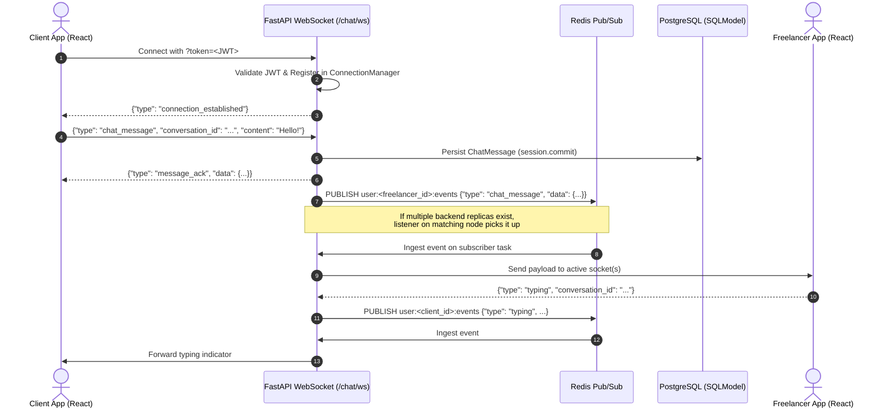
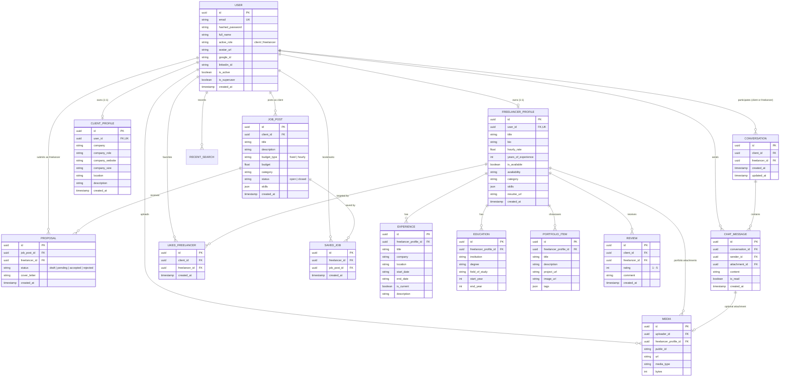
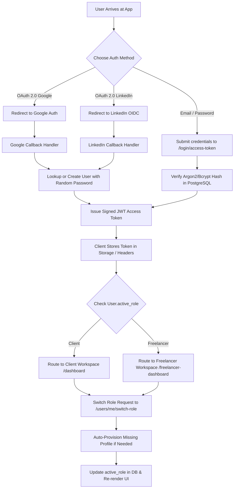
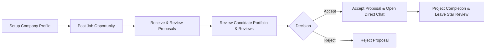
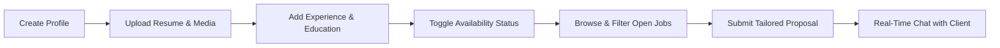

# Freelancer Marketplace - System Architecture & Technical Design

This document details the architectural design, technology stack, system topology, data models, real-time messaging pipeline, workflows, and operational infrastructure of the **Freelancer Marketplace Platform**.

---

## 1. Executive Summary & Architectural Vision

The **Freelancer Marketplace** is a high-performance, full-stack platform connecting independent professionals with businesses. It provides dual-role access (Client and Freelancer) within a unified account, real-time bidirectional messaging, talent and job discovery, proposal management, portfolio showcases, Cloudinary asset hosting, and enterprise-grade secret and disaster recovery operations.

### Key Architectural Characteristics
- **Unified Account & Dynamic Workspace Switching**: Users maintain a single identity and toggle between Client and Freelancer roles on demand, with automatic profile provisioning.
- **Distributed Real-Time Engine**: Built on WebSockets and Redis Pub/Sub, delivering cross-device messaging, typing indicators, presence, and fallback to direct in-memory dispatch when running standalone.
- **Cloud-Native Media Pipeline**: Direct-to-Cloudinary media processing with async streaming proxies for avatars, resumes (PDFs), portfolio showcases, and chat attachments.
- **Enterprise Operations & Security**: Integrated with HashiCorp HCP Vault for externalized secret management, automated PostgreSQL backup daemon with rotation and verification drills, and granular deep health diagnostics.

---

## 2. Technology Stack & Ecosystem

```
┌────────────────────────────────────────────────────────────────────────┐
│                              CLIENT BROWSER                            │
│  React 19 • TypeScript • Vite • TanStack Router & Query • Tailwind v4  │
└───────────────────────────────────┬────────────────────────────────────┘
                                    │ HTTP/2 & WebSockets
                                    ▼
┌────────────────────────────────────────────────────────────────────────┐
│                         TRAEFIK REVERSE PROXY 3.6                      │
│            Port 80/443 Routing • SSL Termination • Host Rules          │
└───────────────────┬───────────────────────────────┬────────────────────┘
                    │                               │
           (HTTP / WebSockets)              (Subdomain Routing)
                    ▼                               ▼
┌───────────────────────────────────────┐   ┌────────────────────────────┐
│         FASTAPI BACKEND (Python 3.14) │   │     ADMINER (DB Viewer)    │
│  FastAPI • SQLModel • Pydantic v2     │   │     adminer.localhost      │
│  Lifespan Engine • Auth & OAuth       │   └────────────────────────────┘
└───────┬──────────────┬──────────────┬─┘
        │              │              │
        ▼              ▼              ▼
┌──────────────┐ ┌───────────┐ ┌─────────────────────────────────────────┐
│ POSTGRESQL 18│ │  REDIS 8  │ │           CLOUDINARY CDN                │
│  Relational  │ │  Pub/Sub  │ │  Avatar / Resume / Portfolio Assets     │
│   Database   │ │ Event Bus │ └─────────────────────────────────────────┘
└───────┬──────┘ └───────────┘
        │
        ▼
┌──────────────────────────────┐
│    BACKUP DAEMON (Postgres)  │
│ Automated Periodic SQL Dumps │
│  Retention & DR Verification │
└──────────────────────────────┘
```

### Backend Technologies
| Technology | Version / Spec | Purpose & Architectural Role |
| :--- | :--- | :--- |
| **Python** | `>=3.14` | Modern runtime utilizing enhanced typing and performance. |
| **FastAPI** | `>=0.141` | High-throughput asynchronous REST and WebSocket API layer. |
| **SQLModel** | `>=0.0.39` | Unified data modeling combining SQLAlchemy 2.0 ORM and Pydantic v2 validation. |
| **Alembic** | `>=1.12` | Schema migrations tracked under version control. |
| **PostgreSQL** | `18` (via `psycopg 3.3`) | Primary ACID relational database with native JSON and UUID support. |
| **Redis** | `>=8.1` (`redis.asyncio`) | In-memory distributed Pub/Sub event bus for real-time user channels. |
| **Cloudinary SDK** | `>=1.46` | Cloud media storage, asset transformations, and secure document CDN. |
| **HTTPX** | `>=0.25` (HTTP/2 enabled) | High-performance pooled async HTTP client for external integrations. |
| **Pwdlib / Passlib** | Argon2 & Bcrypt | Multi-algorithm password hashing with automatic salt rotation. |
| **PyJWT** | `>=2.13` | Stateless signed JSON Web Tokens for API and WebSocket authentication. |
| **OAuth 2.0 Clients** | Google & LinkedIn OIDC | Social authentication with automatic account provisioning and token refresh. |
| **Sentry SDK** | `>=2.66` | Real-time exception tracking and distributed APM tracing in production. |

### Frontend Technologies
| Technology | Version / Spec | Purpose & Architectural Role |
| :--- | :--- | :--- |
| **React** | `19.2` | Modern UI layer leveraging React Compiler, Actions, and enhanced hooks. |
| **TypeScript** | `6.0` | End-to-end type safety shared with backend models via OpenAPI generation. |
| **Vite** | `8.2` (with SWC) | Ultra-fast HMR and bundle compilation. |
| **Tailwind CSS** | `v4.2` (`@tailwindcss/vite`) | Engine-level CSS utility framework with CSS variables for dynamic theming. |
| **TanStack Router** | `1.170` | Type-safe file-based client-side routing with route guards and automatic code splitting. |
| **TanStack Query** | `v5.101` | Declarative server-state caching, background revalidation, and optimistic updates. |
| **shadcn/ui & Radix** | Radix UI Primitives | Accessible, composable UI component primitives with custom styling. |
| **Sonner** | `2.0` | Smooth, stacked notification toasts across user actions. |
| **Hey-API / openapi-ts**| `0.97` | Automated TypeScript SDK generation directly from FastAPI OpenAPI schema. |
| **Biome** | `2.5` | Fast code formatter and linter ensuring code quality. |

### DevOps & Infrastructure
| Component | Implementation | Description |
| :--- | :--- | :--- |
| **Traefik** | `3.6` | Container-aware reverse proxy routing HTTP/WS traffic and managing TLS certificates. |
| **Docker Compose** | Multi-file (`compose.yml`, `override`, `deploy`) | Declarative container orchestration for local dev, watch modes, and production deployments. |
| **HashiCorp HCP Vault** | Bash automation suite (`devops/vault/`) | Centralized secret store with pull/push commands, token generation, and least-privilege policies. |
| **Automated Backup Daemon** | Custom container (`devops/backup/`) | Automated periodic database dumps, gzip compression, retention rotation, and recovery drill scripts. |
| **Mailpit** | `axllent/mailpit` | SMTP sandbox capturing transactional emails (welcome, reset password) locally during development. |

---

## 3. System Design & Component Topology

### 3.1 Network & Reverse Proxy Layer
1. **Traefik** acts as the single external gateway on port `80`/`443`.
2. Requests to `Host: localhost` or `Host: ${DOMAIN}` are routed to the FastAPI backend service (port `8000`).
3. Requests to `Host: adminer.${DOMAIN:-localhost}` route to the Adminer database dashboard.
4. FastAPI serves the built frontend single-page application at `/` via `app.frontend()` when static assets exist, or falls back to pure API when developing with Vite on port `5173`.
5. WebSocket requests (`/api/v1/chat/ws`) pass through Traefik transparently without connection interruption.

### 3.2 Real-Time Event & Messaging Topology



---

## 4. Data Architecture & Entity-Relationship Model (ERD)

The data layer uses SQLModel with explicit foreign keys, composite constraints, cascade delete rules, and JSON types for collections.



### 4.1 Schema Guarantees & Constraints
- **Unique Constraints**:
  - `User.email` — Unique user identity.
  - `(client_id, freelancer_id)` in `Review` — Prevents multiple reviews by the same client on a single freelancer.
  - `(job_post_id, freelancer_id)` in `Proposal` — One active proposal per freelancer per job post.
  - `(client_id, freelancer_id)` in `LikedFreelancer` — Deduplicated talent bookmarking.
  - `(freelancer_id, job_post_id)` in `SavedJob` — Deduplicated job bookmarking.
  - `(client_id, freelancer_id)` in `Conversation` — Canonical single chat thread per pair.
- **Cascade Deletes**: Deleting a `User` cascades to their profiles, uploaded media, job posts, proposals, messages, and reviews.

---

## 5. Authentication, Authorization & Identity Architecture



### 5.1 Dual-Role Identity Model
Rather than forcing users into separate accounts for hiring and freelancing:
1. Every user has an `active_role` field (`client` or `freelancer`).
2. When registering as a freelancer, an empty draft `FreelancerProfile` is automatically created.
3. When registering as a client, an empty draft `ClientProfile` is automatically created.
4. Calling `POST /api/v1/users/me/switch-role` toggles the active role. If the target profile does not exist yet, the backend automatically initializes it.
5. In the frontend, `AppLayout` inspects `useAccountRole()` and dynamically guards routes:
   - Freelancers accessing client routes (`/dashboard`, `/talent`, `/client-jobs`) are redirected to `/freelancer-dashboard` or corresponding freelancer views.
   - Clients accessing `/freelancer-*` routes are redirected to `/dashboard`.

### 5.2 Social OAuth 2.0 Implementation
- **Google OAuth**: Requests `openid email profile` scopes, captures offline refresh tokens, fetches user information, and links Google IDs.
- **LinkedIn OIDC**: Implements PKCE/state cookie validation, queries the LinkedIn OIDC UserInfo endpoint, and populates name and profile picture.
- **Secure Fallback Passwords**: Newly provisioned OAuth accounts receive a cryptographically random 12-character hashed password, ensuring database integrity and preventing null-password bypasses.

---

## 6. Real-Time Messaging & Distributed Event Pipeline

### 6.1 Multi-Tier Dispatch Architecture
The real-time system is engineered for zero-loss message delivery, supporting both single-node local development and multi-replica distributed production clusters:

```
[REST / WebSocket Trigger]
          │
          ▼
┌──────────────────┐       Success
│ Redis Available? ├─────────────────────► [Publish to Redis Pub/Sub]
└─────────┬────────┘                                   │
          │ Failed / Not connected                     │
          ▼                                            ▼
[In-Memory ConnectionManager] ◄──────────── [Redis Listener Task]
          │                                            │
          └─────────────────────┬──────────────────────┘
                                │
                                ▼
                   [Active WebSocket Clients]
```

1. **Redis Pub/Sub Channels**:
   - `user:{user_id}:events` — Direct targeted messages, typing alerts, and read receipts.
   - `events:broadcast` — System-wide announcements and broadcast notifications.
2. **Graceful Fallback**: If Redis is temporarily unreachable or offline in local dev, `publish_to_user` logs a warning and immediately falls back to direct in-memory delivery via the local `ConnectionManager`.
3. **Multi-Tab Support**: `ConnectionManager` stores a `set[WebSocket]` for each `user_id`. When a message arrives, it is broadcast to all active tabs/devices of that user simultaneously. Dead sockets are pruned automatically upon disconnection.
4. **WebSocket Frame Protocol**:
   - `ping` / `pong` — Heartbeat liveness monitoring.
   - `chat_message` — Bidirectional messaging with client acknowledgement (`message_ack`) and database persistence.
   - `typing` — Real-time typing indicators with auto-clear timeouts.
   - `connection_established` — Initial handshake confirming authenticated user UUID.

---

## 7. Application Workflows & User Journeys

### 7.1 Client Lifecycle



1. **Company Onboarding**: Define company name, website, role, team size, and background description.
2. **Job Posting**: Choose between Fixed Price or Hourly Rate, select budget amount, categorize the project, and tag required skills.
3. **Candidate Screening**: Inspect incoming proposals, examine cover letters, view freelancer profiles with past reviews and verified ratings.
4. **Talent Sourcing**: Search the talent directory independently, apply skill/rate filters, and save candidates to the "Saved Talent" list.
5. **Direct Hiring & Communication**: Launch a conversation via `/api/v1/chat/initiate/{freelancer_id}` and collaborate through real-time chat.
6. **Feedback Loop**: Write a 1-to-5 star review and comment that updates the freelancer's public reputation score.

### 7.2 Freelancer Lifecycle



1. **Profile Building**: Set headline title, bio, hourly rate, timezone, and languages.
2. **Credential Showcasing**:
   - Upload resume PDF (streamed and securely hosted via Cloudinary).
   - Add work experiences (company, timeline, current position flag).
   - Add formal education records.
   - Add portfolio projects with screenshots, tags, and live repository/product links.
3. **Availability Management**: Toggle live availability status (`is_available` boolean) with immediate visibility on public talent cards.
4. **Opportunity Discovery**: Filter jobs by keyword, category, budget type, and matching skills. Bookmark jobs into "Saved Jobs".
5. **Proposal Management**: Draft, submit, and track proposals through status stages (`pending` -> `accepted` / `rejected`).
6. **Direct Messaging**: Receive instant client messages, type replies with real-time feedback, and exchange project deliverables.

---

## 8. DevOps, Security & Disaster Recovery

### 8.1 HashiCorp HCP Vault Integration
Secrets are externalized from the code repository and synced via scripted workflows (`devops/vault/`):
- **Pull Secrets**: `make env` pulls production keys directly from HCP Vault to `.env`.
- **Local Dev Fallbacks**: `make env-dev` populates safe development fallbacks if specific cloud keys are unassigned.
- **Push Secrets**: `make push` syncs local environment configurations back to HCP Vault with dry-run support (`make push-dry`).
- **Least-Privilege Tokens**: `make token NAME=<developer>` generates bounded read-only developer access tokens.

### 8.2 Database Backup Daemon & Disaster Recovery
A standalone alpine Postgres service (`backup-daemon`) runs continuously in Docker Compose:
- **Automated Cadence**: Dumps PostgreSQL using `pg_dump` on a configurable schedule (`BACKUP_INTERVAL_SECONDS`, default: 3600s).
- **Gzip Compression**: Backups are compressed to `.sql.gz` and saved to `./devops/backup/dumps/`.
- **Retention Management**: Retains the last `N` dumps (`BACKUP_KEEP_LAST`, default: 10) and automatically purges older archives.
- **Disaster Recovery Drill**: `make dr-test` runs an automated DR drill that spins up an isolated sandbox database, restores the latest backup, verifies table counts and relational integrity, and tears down the sandbox.

### 8.3 Deep Health Monitoring & Public Status Page
The platform features an automated observability system exposed via `/api/v1/utils/health/detailed` and rendered at `/status`:
- **Database Diagnostic**: Runs an active `SELECT 1` query and measures roundtrip query latency in milliseconds.
- **Disk Storage Diagnostic**: Checks filesystem storage capacity, reporting free GB, total GB, and percentage available (warning on `<10%`).
- **Secrets Diagnostic**: Confirms encryption keys and superuser credentials are valid and not using template defaults.
- **Email Sandbox Status**: Verifies SMTP configuration and reachability.
- **Interactive UI**: The `/status` page auto-refreshes every 10 seconds, visualizing system uptime, service cards, and real-time latency indicators.

---

## 9. Feature Inventory & API Mapping Matrix

| Domain | Feature Capability | Backend Endpoint | Frontend Route / Component |
| :--- | :--- | :--- | :--- |
| **Auth** | OAuth 2.0 Google | `GET /login/google`, `GET /login/google/callback` | `/googleAuth`, `AuthModal` |
| **Auth** | OAuth 2.0 LinkedIn | `GET /login/linkedin`, `GET /login/linkedin/callback` | `/linkedinAuth`, `AuthModal` |
| **Auth** | Password Authentication | `POST /login/access-token` | `/login`, `/signup` |
| **Auth** | Password Recovery | `POST /password-recovery/{email}`, `POST /reset-password/` | `/recover-password`, `/reset-password` |
| **User** | Role Switching | `POST /users/me/switch-role` | `AppLayout`, `useAccountRole` |
| **User** | Avatar Upload | `POST /users/me/avatar` | `useAccountAvatar`, Settings |
| **Freelancer** | Profile Management | `GET /profiles/me`, `PUT /profiles/me` | `/freelancer-profile`, `FreelancerProfileView` |
| **Freelancer** | Availability Toggle | `GET /profiles/me/availability`, `PATCH /profiles/me/availability` | `useFreelancerAvailability` |
| **Freelancer** | Experience Records | `POST, PUT, DELETE /profiles/me/experiences` | `FreelancerProfileComponents` |
| **Freelancer** | Education Records | `POST, PUT, DELETE /profiles/me/educations` | `FreelancerProfileComponents` |
| **Freelancer** | Portfolio & Media | `POST, PUT, DELETE /profiles/me/portfolio`, `POST /profiles/resume` | `DemoWork`, `MediaUploader` |
| **Talent** | Talent Directory & Search | `GET /profiles/` (with filters & search) | `/talent`, `TalentDirectoryPage` |
| **Talent** | Talent Detail View | `GET /profiles/{id}` | `/talent/$freelancerId`, `TalentProfilePage` |
| **Talent** | Save / Favorite Freelancer | `POST, DELETE /profiles/{id}/save` | `useSavedTalent`, `FreelancerCard` |
| **Jobs** | Job Posting & Management | `POST, PUT, DELETE /jobs/` | `/client-jobs`, `ClientJobEditor` |
| **Jobs** | Browse & Search Jobs | `GET /jobs/` (category, budget, skills) | `/freelancer-jobs`, `FreelancerJobsPage` |
| **Jobs** | Save / Bookmark Job | `POST, DELETE /jobs/{id}/save` | `useSavedJobs`, `FreelancerJobCard` |
| **Proposals**| Submit Proposal | `POST /proposals/` | `FreelancerJobDetails`, `ApplyDialog` |
| **Proposals**| Proposal Status Lifecycle | `PUT /proposals/{id}/status` | `FreelancerProposalsPage`, Client Job View |
| **Messaging**| WebSocket Chat & Typing | `WS /chat/ws?token=...` | `/messages`, `/freelancer-messages`, `MessageThread` |
| **Messaging**| Conversation History | `GET /chat/me`, `GET /chat/conversation/{id}/messages` | `ConversationList`, `useMessageContacts` |
| **Reviews** | Post & View Reviews | `POST /reviews/`, `GET /reviews/freelancer/{id}` | `ReviewCard`, Freelancer Profile |
| **System** | Deep Health & Status | `GET /utils/health/detailed` | `/status`, `StatusPage` |
