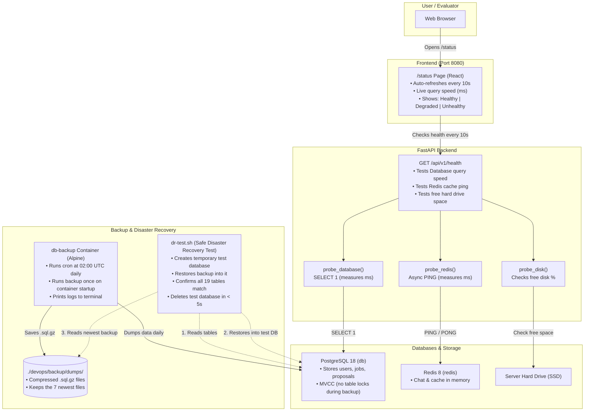

# 🛡️ Stage 5: Health Check, Automated Backups & Disaster Recovery
### Technical Architecture & Operations Guide (Module IV.7 Minor — 1 Pt)

---

## 1. System Overview: Detect, Backup, and Verify

In production DevOps, backups and monitoring work together in three simple steps:

```text
 ┌────────────────────────┐      ┌────────────────────────┐      ┌────────────────────────┐
 │       1. DETECT        │ ──▶  │       2. BACKUP        │ ──▶  │        3. VERIFY       │
 │   Deep Health Check    │      │  Zero-Downtime Backups │      │   Instant Restore &    │
 │  & Public /status Page │      │  Daily Automated Cron  │      │  Sandbox Test (< 5s)   │
 └────────────────────────┘      └────────────────────────┘      └────────────────────────┘
```



---

## 2. Core Concepts Explained (Simple & Plain English)

Here are the main technical concepts evaluators will ask you to explain:

### 2.1 The 4 Key Metrics: RPO, RTO, MTTD & MTTR

```text
   Last Backup             Outage Detected                      Full Recovery
   (02:00 UTC)               (10:04 UTC)                         (10:07 UTC)
───────●─────────────────────────▲───────────────────────────────────●───────▶
       │ ◄────── RPO ───────────►│ ◄────────── RTO / MTTR ──────────►│
       │   (Max Data Loss Window)│    (System Downtime Window)       │
       │                         │                                   │
                              MTTD (Detection Window ≤ 10s)
```

1. **RPO (Recovery Point Objective) — "How much data can we lose?":**
   - The maximum age of data that can be lost in a disaster.
   - **Our System:** Backups run automatically every night at **02:00 UTC**, on container startup, and whenever you run `make backup`. Maximum possible data loss is bounded to that schedule.
2. **RTO (Recovery Time Objective) — "How fast can we bring the site back up?":**
   - The time it takes from declaring a disaster until the database is back online.
   - **42 Subject Rule:** **$\text{RTO} < 60\text{ seconds}$**.
   - **Our System:** **$< 5\text{ seconds}$** (measured live during `make dr-test`).
3. **MTTD (Mean Time To Detect) — "How fast do we notice a crash?":**
   - Average time required to detect that a service is down.
   - **Our System:** **$\le 10\text{ seconds}$** because the `/status` page auto-polls `/api/v1/health` every 10 seconds.
4. **MTTR (Mean Time To Recover) — "How fast can we fix it?":**
   - Average time to restore the database once diagnosed.
   - **Our System:** **$< 15\text{ seconds}$** using the single command `make restore`.

---

### 2.2 PostgreSQL MVCC: Backups Without Freezing Users

In older databases, taking a backup locks tables. That means users cannot register, post jobs, or submit proposals while the backup runs.

PostgreSQL uses **MVCC (Multi-Version Concurrency Control)**:
* When `pg_dump` starts, it creates a snapshot of data at that exact millisecond (`REPEATABLE READ`).
* It reads that snapshot while users continue using the website normally.
* **Result:** Zero downtime, zero table locking.

---

### 2.3 Streaming Compression in Memory (`pg_dump | gzip -9`)

* **Slow Way:** Dump a huge uncompressed `.sql` file to the hard drive, then compress it. This takes twice the disk space and slows down the server.
* **Our Way:** We stream the output of `pg_dump` directly through a Linux pipe into `gzip -9`:
  ```bash
  pg_dump ... | gzip -9 > backup_file.sql.gz
  ```
  - **`gzip -9`:** Maximum compression (saves ~85% disk space).
  - **In Memory:** Data is compressed on the fly in RAM before touching the disk.

---

### 2.4 Archive Integrity Check (`gzip -t`)

An untested backup file is useless if it is corrupt. Immediately after creating a backup, our script checks it:
```bash
gzip -t "${BACKUP_FILE}"
```
This tests the archive's internal checksum (CRC-32). If the file is incomplete or damaged, the script fails immediately.

---

### 2.5 Automatic Cleanup Trap (Deleting Corrupted Files)

In Bash, `> file` creates an empty file on disk *before* the command finishes. If PostgreSQL crashes halfway through, you are left with an empty or broken 20-byte file.

Our [`backup.sh`](../../backup/backup.sh) script uses a Bash `trap`:
```bash
trap 'if [ $? -ne 0 ] && [ -f "${BACKUP_FILE:-}" ]; then rm -f "${BACKUP_FILE}"; fi' EXIT
```
If anything fails during the backup, the trap catches the error and **deletes the broken file automatically**.

---

### 2.6 Keeping the 7 Newest Files (`MAX_BACKUPS=7`)

To make sure the server hard drive never runs out of space:
* The script sorts all backups from oldest to newest: `ls -1tr backup_*.sql.gz`.
* If there are more than 7 files, it deletes the oldest ones one by one.
* **Result:** Storage stays small and predictable at all times.

---

## 3. Key Design Decisions (The "Why")

When defending your project, evaluators will ask why you chose this design:

| Design Choice | What We Chose | Why We Chose It |
| :--- | :--- | :--- |
| **1. Backup Runner** | Dedicated Alpine container (`db-backup`) running cron. | **No host dependencies**: No need to install PostgreSQL on the host OS. The container uses PostgreSQL 18 client tools that match the database exactly, avoiding `pg_dump` version conflicts. |
| **2. One Script for Both** | Dual-mode scripts (`backup.sh`, `restore.sh`). | The script detects if it is running inside the container or on your host machine. Developers and cron use the exact same script. |
| **3. Kill Connections on Restore** | `SELECT pg_terminate_backend(pid)` before restore. | If the backend app is connected to the database, it holds open locks. Terminating active client connections allows instant schema reset without freezing. |
| **4. Reset Schema Instead of DB** | Drop and recreate schema `public` (`DROP SCHEMA public CASCADE; CREATE SCHEMA public;`). | Dropping the whole database requires disconnecting, reconnecting to the maintenance DB, and re-granting permissions. Resetting the `public` schema is instant and keeps permissions intact. |
| **5. Safe Disaster Recovery Drill** | Ephemeral sandbox database (`dr-test.sh`). | Tests that recovery works without touching or risking real production user data. |

---

## 4. Step-by-Step How It Works

### 4.1 Daily Automated Backup Daemon ([`entrypoint.sh`](../../backup/entrypoint.sh))

When you run `docker compose up`, the `db-backup` container starts:
1. **Wait for DB:** Uses `pg_isready` until PostgreSQL is ready to take connections.
2. **First-Run Backup:** Runs one backup on startup to verify permissions and credentials.
3. **Setup Cron:** Schedules `backup.sh` to run every night at **02:00 UTC** (`0 2 * * *`).
4. **Log Forwarding:** Forwards cron logs to `docker compose logs -f db-backup`.

---

### 4.2 Restoring the Database ([`restore.sh`](../../backup/restore.sh))

If someone accidentally deletes data, run:
```bash
make restore
# Or restore a specific backup file:
make restore FILE=backup_app_20261101_020000.sql.gz
```
1. Selects the newest backup file in `devops/backup/dumps/`.
2. Tests file integrity with `gzip -t`.
3. Closes existing client connections (`pg_terminate_backend`).
4. Streams the compressed file directly into `psql`:
   ```bash
   gzip -dc "${BACKUP_FILE}" | psql -d app
   ```
5. Confirms all 19 public tables are restored successfully.

---

### 4.3 Safe Disaster Recovery Test Drill ([`dr-test.sh`](../../backup/dr-test.sh))

Run the test drill anytime:
```bash
make dr-test
```

```text
 1. Check production DB ──▶ Counts 19 public tables in 'app'
 2. Create sandbox DB   ──▶ CREATE DATABASE dr_drill_sandbox
 3. Restore backup      ──▶ Restores latest backup into 'dr_drill_sandbox'
 4. Verify tables       ──▶ Confirms all 19 tables match production
 5. Clean up            ──▶ Drops 'dr_drill_sandbox' cleanly in < 5s
```
* **Real site stays online** with zero interruption.
* Proves that our **RTO is $< 5\text{ seconds}$** (well below the 60s subject rule).

---

### 4.4 Real-Time Health Check ([`health.py`](../../../backend/app/api/routes/health.py) & [`status.tsx`](../../../frontend/src/routes/status.tsx))

The endpoint `GET /api/v1/health` actively tests three components:
1. **PostgreSQL:** Runs `SELECT 1` and records query speed in milliseconds (e.g. `1.2 ms`).
2. **Redis:** Sends `PING` and records response speed (e.g. `0.8 ms`).
3. **Hard Disk:** Checks free space with `shutil.disk_usage('/')`.

**HTTP Status Codes:**
* 🟢 **`200 OK` (Healthy):** All three components are working normally.
* 🟡 **`200 OK` (Degraded):** Redis is down (or disk $< 10\%$). The website still works, but chat is offline.
* 🔴 **`503 Service Unavailable` (Unhealthy):** PostgreSQL is down (or disk $< 5\%$). Tells Traefik and users the app cannot operate.

The React [`/status`](../../../frontend/src/routes/status.tsx) page automatically polls this endpoint every 10 seconds.
