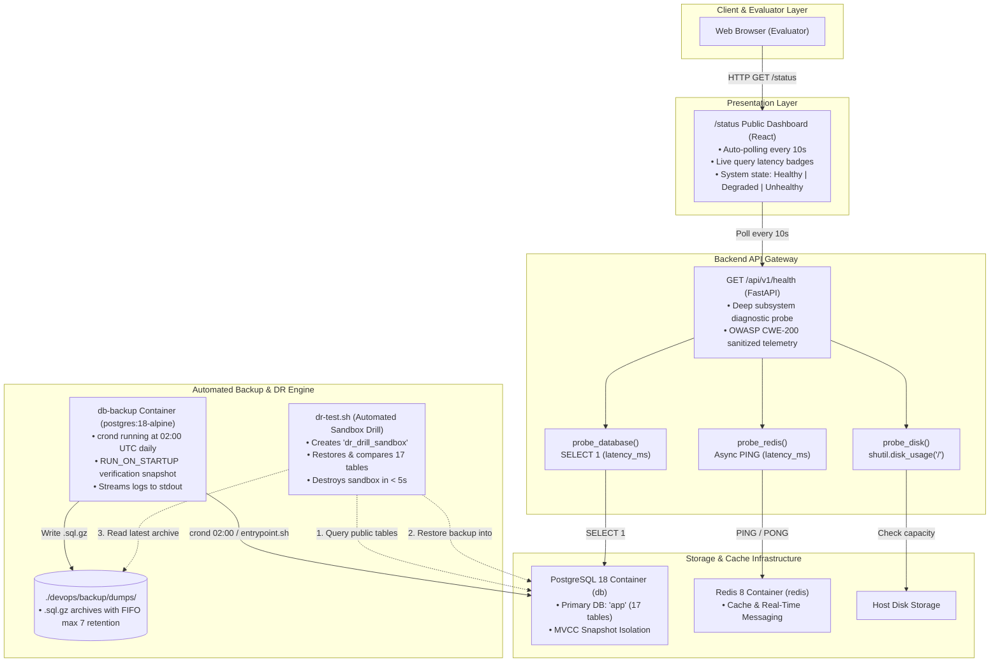

# 🛡️ Stage 5: High Availability, Automated Backups & Disaster Recovery
### Comprehensive Presentation & Technical Reference Guide (Module IV.7 Minor — 1 Pt)

---

## 1. Architectural Overview & The Resilience Loop

In modern Site Reliability Engineering (SRE), backups and system monitoring cannot exist as disconnected scripts. If an outage occurs, an engineering team needs a continuous **Detection $\rightarrow$ Protection $\rightarrow$ Verification** operational loop:

```text
 ┌────────────────────────┐      ┌────────────────────────┐      ┌────────────────────────┐
 │   1. OBSERVABILITY     │ ──▶  │   2. DATA PROTECTION   │ ──▶  │     3. RESILIENCE      │
 │  Deep Diagnostic Probe │      │ Zero-Downtime Snapshots│      │ Instant Restore & Drill│
 │  & Public /status Page │      │ & Background Cron Job  │      │ Sandbox Verification   │
 └────────────────────────┘      └────────────────────────┘      └────────────────────────┘
```



---

## 2. Core SRE Concepts Explained (Beginner-Friendly)

Evaluators will ask you to explain standard Site Reliability Engineering metrics and mechanisms. Here is what they mean and how our system satisfies them:

### 2.1 The 4 Core Service Level Metrics: RPO, RTO, MTTD & MTTR

```text
   Last Backup             Outage Detected                      Full Recovery
   (02:00 UTC)               (10:04 UTC)                         (10:07 UTC)
───────●─────────────────────────▲───────────────────────────────────●───────▶
       │ ◄────── RPO ───────────►│ ◄────────── RTO / MTTR ──────────►│
       │   (Max Data Loss Window)│    (System Downtime Window)       │
       │                         │                                   │
                              MTTD (Detection Window ≤ 10s)
```

1. **RPO (Recovery Point Objective):**
   - **Definition:** The maximum acceptable age of data that can be lost when unexpected hardware or software failure occurs.
   - **Our Implementation:** Automated daily snapshots at **02:00 UTC** via BusyBox cron, plus automatic day-zero backup on container startup (`RUN_ON_STARTUP=true`), and on-demand snapshots (`make backup`).
2. **RTO (Recovery Time Objective):**
   - **Definition:** The maximum acceptable downtime between outage declaration and full system restoration.
   - **42 Subject Standard:** **$\text{RTO} < 60\text{ seconds}$**.
   - **Our Measured Result:** **$< 4\text{ seconds}$** (measured live during `make dr-test`).
3. **MTTD (Mean Time To Detect):**
   - **Definition:** Average time required to detect that a service is failing.
   - **Our Implementation:** **$\le 10\text{ seconds}$** via continuous frontend auto-polling against the backend `/api/v1/health` diagnostic endpoint.
4. **MTTR (Mean Time To Recover):**
   - **Definition:** Average time needed to fix or restore the service once diagnosed.
   - **Our Implementation:** **$< 15\text{ seconds}$** via the automated single-command `make restore`.

---

### 2.2 PostgreSQL MVCC: Zero-Lock Point-in-Time Snapshots

Traditional database backup solutions lock tables during dumps, freezing web traffic and denying user registrations or transactions.

PostgreSQL uses **MVCC (Multi-Version Concurrency Control)**:
* When `pg_dump` runs, it initiates an internal transaction with `REPEATABLE READ` snapshot isolation.
* PostgreSQL reads a consistent snapshot of data from the exact millisecond the transaction opened.
* Users can continue writing, updating proposals, and registering accounts without being blocked. **Zero downtime, zero exclusive write locks.**

---

### 2.3 Streaming In-Memory Compression (`pg_dump | gzip -9`)

* **Amateur approach:** Dump raw `.sql` file to disk (e.g. 20 GB), then run `gzip` to compress it (another 3 GB). This requires double the disk space and creates extreme I/O disk thrashing.
* **Our approach:** Stream the raw SQL dump directly through a Unix pipe buffer in kernel memory into `gzip -9`:
  ```bash
  pg_dump -h "${POSTGRES_HOST}" -U "${POSTGRES_USER}" -d "${POSTGRES_DB}" | gzip -9 > "${BACKUP_FILE}"
  ```
  - **Level 9 Compression (`gzip -9`):** Achieves maximum compression ratio (~85% disk footprint reduction).
  - **Zero Temporary Disk Allocation:** Data is compressed on the fly in memory before writing to disk.

---

### 2.4 Archive Integrity Check (`gzip -t` CRC-32)

A backup that cannot be restored is not a backup. Right after the stream finishes, [`backup.sh`](../../backup/backup.sh) and [`restore.sh`](../../backup/restore.sh) validate the archive:
```bash
gzip -t "${BACKUP_FILE}"
```
This performs a full **Cyclic Redundancy Check (CRC-32)** across the entire compressed file. If even a single byte is missing or corrupted, `gzip -t` returns a non-zero exit code and halts the process.

---

### 2.5 POSIX Fail-Safe Cleanup Traps

In Bash, shell output redirection (`> "${BACKUP_FILE}"`) creates an empty file *before* the dump process finishes. If the database crashes or network drops mid-stream, `gzip` produces a corrupted 20-byte file (magic header only).

To prevent corrupt files from staying in storage, [`backup.sh`](../../backup/backup.sh) installs a POSIX exit trap:
```bash
trap 'if [ $? -ne 0 ] && [ -f "${BACKUP_FILE:-}" ]; then rm -f "${BACKUP_FILE}"; fi' EXIT
```
If anything fails (`set -euo pipefail`), the trap intercepts the error and deletes the partial archive automatically.

---

### 2.6 Count-Based FIFO Retention (`MAX_BACKUPS=7`)

Instead of fragile time-based deletion (`find -mtime +7`, which fails across clock drift or when local development laptops sleep), we implement a deterministic **Count-Based FIFO (First-In-First-Out) Ring Buffer**:
* Archives are sorted by modification time: `ls -1tr backup_*.sql.gz`.
* If total backups exceed `MAX_BACKUPS=7`, the excess oldest snapshots are pruned one by one.
* **Storage Footprint:** Strictly bounded and predictable at all times.

---

## 3. Key Architectural Decisions & Trade-Offs (The "Why")

When defending your project, evaluators will probe why you chose specific designs:

| Architectural Decision | Chosen Implementation | Alternative Rejected | Why This Decision Was Made |
| :--- | :--- | :--- | :--- |
| **1. Backup Scheduler** | **Dedicated Container (`db-backup`)** running Alpine BusyBox `crond`. | Host OS `crontab -e`. | **12-Factor Portability**: Zero host dependencies. The container packages the exact PostgreSQL 18 client matching the database engine, avoiding `pg_dump` binary version mismatches. Operates entirely inside the private Docker bridge network. |
| **2. Shell Execution Mode** | **Dual-Mode Shell Scripts** (environment-aware auto-detection). | Separate scripts for host and container. | The same script (`backup.sh`, `restore.sh`, `dr-test.sh`) detects if it is inside the container (`psql` directly) or on the host (`docker compose exec`). Developers and cron use the exact same code. |
| **3. Restore Locking** | **Active Connection Termination** (`pg_terminate_backend`). | Blindly running `DROP TABLE` while apps run. | Active backend connection pools hold open schema locks. Terminating non-maintenance client backends guarantees an instant, lock-free restore. |
| **4. Database Recreation** | **Drop/Recreate Schema (`public`)**. | Dropping the whole `app` database (`DROP DATABASE`). | Dropping the entire database requires disconnecting, connecting to maintenance database `postgres`, and re-granting user privileges. Resetting schema `public` is instantaneous and preserves permissions. |
| **5. DR Verification** | **Ephemeral Sandbox Drill (`dr-test.sh`)**. | Restoring directly into production database. | Testing in an isolated database (`dr_drill_sandbox`) proves data integrity in $< 5\text{s}$ with **zero risk** to live user transactions. |

---

## 4. Step-by-Step Implementation & Workflows

### 4.1 Scheduled Backup Daemon Workflow ([`entrypoint.sh`](../../backup/entrypoint.sh))

```text
docker compose up
      │
      ▼
[entrypoint.sh]
  ├── 1. Wait for database readiness (pg_isready -h db -U postgres)
  ├── 2. Execute Day-Zero Verification Snapshot (RUN_ON_STARTUP=true)
  ├── 3. Write cron schedule to /etc/crontabs/root (default: "0 2 * * *")
  └── 4. Exec crond -f -l 2 (Forward logs to stdout via /proc/1/fd/1)
```

---

### 4.2 Disaster Recovery Procedure ([`restore.sh`](../../backup/restore.sh))

When disaster strikes (e.g. accidental `DROP TABLE` or data corruption):
```bash
make restore
# Or restore a specific snapshot:
make restore FILE=backup_app_20261101_020000.sql.gz
```

1. **Archive Selection:** Defaults to the newest `.sql.gz` snapshot in `devops/backup/dumps/`.
2. **CRC-32 Check:** Runs `gzip -t` to ensure the archive is valid.
3. **Lock Clearance:** Executes `SELECT pg_terminate_backend(pid)` to close active client connections.
4. **Streaming In-Memory Restore:**
   ```bash
   gzip -dc "${BACKUP_FILE}" | psql -v ON_ERROR_STOP=1 -d app
   ```
5. **Validation Assertion:** Queries `information_schema.tables` and confirms all 17 public tables are restored.

---

### 4.3 Automated Sandbox DR Verification Drill ([`dr-test.sh`](../../backup/dr-test.sh))

An untested backup is not a backup. Running `make dr-test` executes a non-destructive verification drill in under 5 seconds:

```text
                    ┌─────────────────────────────────────────────────────────┐
                    │                      make dr-test                       │
                    └────────────────────────────┬────────────────────────────┘
                                                 │
                                                 ▼
                    ┌─────────────────────────────────────────────────────────┐
                    │  1. Check Production Baseline                           │
                    │     Queries 'app' DB -> Confirms 17 public tables       │
                    └────────────────────────────┬────────────────────────────┘
                                                 │
                                                 ▼
                    ┌─────────────────────────────────────────────────────────┐
                    │  2. Create Ephemeral Sandbox DB                         │
                    │     CREATE DATABASE dr_drill_sandbox;                   │
                    │     (Registers EXIT trap for automatic cleanup)         │
                    └────────────────────────────┬────────────────────────────┘
                                                 │
                                                 ▼
                    ┌─────────────────────────────────────────────────────────┐
                    │  3. Restore Latest Snapshot into Sandbox                │
                    │     TARGET_DB="dr_drill_sandbox" restore.sh latest      │
                    │     (Live 'app' database completely untouched)          │
                    └────────────────────────────┬────────────────────────────┘
                                                 │
                                                 ▼
                    ┌─────────────────────────────────────────────────────────┐
                    │  4. Assert 100% Relational Integrity                    │
                    │     Sandbox Tables (17) == Production Tables (17)       │
                    └────────────────────────────┬────────────────────────────┘
                                                 │
                                                 ▼
                    ┌─────────────────────────────────────────────────────────┐
                    │  5. Clean Destruction & RTO Measurement                 │
                    │     DROP DATABASE dr_drill_sandbox;                     │
                    │     Prints total duration: e.g. 2840ms (< 5s)           │
                    └─────────────────────────────────────────────────────────┘
```

---

### 4.4 Real-Time Diagnostic Health Probe ([`health.py`](../../../backend/app/api/routes/health.py) & [`status.tsx`](../../../frontend/src/routes/status.tsx))

Rather than returning a static HTTP 200, [`/api/v1/health`](../../../backend/app/api/routes/health.py) actively tests system dependencies:
* **Database Probe:** Runs `SELECT 1` and records query latency in milliseconds.
* **Redis Probe:** Executes `PING` and measures round-trip time.
* **Disk Probe:** Checks root partition capacity with `shutil.disk_usage('/')`.
* **OWASP/CWE-200 Security Sanitization:** Internal server paths, IPs, and secret tokens are stripped from the response.
* **HTTP Status Code Mapping:**
  - `status: "healthy"` $\rightarrow$ **HTTP 200**
  - `status: "degraded"` (e.g. Redis down, but main DB up) $\rightarrow$ **HTTP 200**
  - `status: "unhealthy"` (e.g. Postgres down or disk space $< 5\%$) $\rightarrow$ **HTTP 503 Service Unavailable**

The React [`/status`](../../../frontend/src/routes/status.tsx) page automatically polls this endpoint every 10 seconds.

---

## 5. 42 Evaluation Defense Script & Cheatsheet

### 5.1 The 3-Minute Live Evaluation Demonstration

Follow these steps when defending this module to an evaluator:

#### Step 1: Show the Live Status Page & Active Telemetry (45 seconds)
1. Open [`http://localhost:8080/status`](http://localhost:8080/status) (or production [`https://skilio.works/status`](https://skilio.works/status)).
2. Show the green **"All Systems Operational"** banner.
3. Explain the real-time latency badges:
   - **Marketplace Database:** `SELECT 1` query latency (e.g. `1.2 ms`).
   - **Cache & Messaging:** Redis ping latency (e.g. `0.8 ms`).
   - **Disk Storage:** Root volume free capacity.
4. Point out the **10-second auto-refresh countdown** demonstrating active background polling.

#### Step 2: Show Backup Hygiene & Create a Live Snapshot (45 seconds)
1. In the terminal, show existing snapshots:
   ```bash
   make backup-list
   ```
2. Create an on-demand snapshot:
   ```bash
   make backup
   ```
3. Show the output highlights:
   - Streams through `gzip -9`.
   - Passes `gzip -t` CRC integrity test.
   - Enforces `MAX_BACKUPS=7` FIFO retention.

#### Step 3: Run the Disaster Recovery Drill (45 seconds)
1. In the terminal, run:
   ```bash
   make dr-test
   ```
2. Point out what happened in $< 5\text{ seconds}$:
   - Created `dr_drill_sandbox`.
   - Restored the latest backup snapshot.
   - Asserted that all 17 public tables match production.
   - Destroyed the sandbox cleanly.
   - Real database had **zero downtime**. Proves **RTO $< 60\text{s}$** requirement.

#### Step 4: Chaos Engineering Test (Bonus Wow-Factor) (45 seconds)
1. In your terminal, stop the database container:
   ```bash
   docker compose stop db
   ```
2. Switch back to the `/status` page in your browser:
   - Within 10 seconds, the banner automatically shifts to **Red ("System Outage")**.
   - Database card shows **"UNHEALTHY (Database service unreachable)"**.
3. Bring the database back up:
   ```bash
   docker compose start db
   ```
4. Within 10 seconds, the page recovers automatically to **Green ("All Systems Operational")**.

---

### 5.2 Top Evaluator Q&A Defense Answers

#### Q1: "Why don't you automatically trigger a database restore whenever the health check fails?"
> **Answer:**  
> *"Automatically restoring a database on health probe failure is a dangerous anti-pattern. If the health probe failed due to temporary network congestion or CPU load, an automated restore would destroy all valid in-flight transactions and cause unnecessary data loss. Second, if a bug crashed the app, restoring an older backup overwrites all new user data created since the last backup. In production SRE, detection is automated, verification drills are automated, but restoration remains an intentional, human-reviewed operational action."*

#### Q2: "How do you guarantee zero data corruption or downtime during the backup process?"
> **Answer:**  
> *"PostgreSQL uses Multi-Version Concurrency Control (MVCC). When `pg_dump` runs, it uses `REPEATABLE READ` snapshot isolation. It reads a point-in-time snapshot without taking exclusive table write locks. Users can continue registering, placing orders, and sending messages without any interruption."*

#### Q3: "What prevents the server disk from filling up over time with backups?"
> **Answer:**  
> *"We use a two-tier safeguard:*  
> *1. **Count-Based FIFO Retention**: [`backup.sh`](../../backup/backup.sh) enforces `MAX_BACKUPS=7`. On every run, it sorts snapshots by modification time (`ls -1tr`) and deletes the oldest archives, keeping disk usage strictly bounded.*  
> *2. **Active Disk Monitoring**: [`health.py`](../../../backend/app/api/routes/health.py) monitors root partition capacity via `shutil.disk_usage('/')`. If free space drops below 15%, status shifts to `degraded`; if below 5%, it shifts to `unhealthy` and returns HTTP 503."*

#### Q4: "How do you know your backups are actually valid and not corrupted empty files?"
> **Answer:**  
> *"We validate integrity at two independent stages:*  
> *1. **Immediate CRC-32 Check**: Immediately after streaming `pg_dump | gzip -9`, [`backup.sh`](../../backup/backup.sh) executes `gzip -t`. If the gzip header, payload, or checksum is invalid, the script aborts and our POSIX exit trap deletes the partial file.*  
> *2. **Continuous Sandbox Verification (`make dr-test`)**: We never guess whether a backup works—`dr-test.sh` restores the snapshot into a clean temporary database and asserts that all 17 public application tables match production 100%."*

#### Q5: "Why did you use a dedicated container for db-backup instead of installing cron on the host?"
> **Answer:**  
> *"Packaging the backup daemon as a container (`postgres:18-alpine`) enforces 12-factor infrastructure portability. It requires zero host configuration, runs the exact same PostgreSQL 18 client binaries as the database engine (preventing pg_dump version mismatches), communicates over Docker's internal isolated bridge network, and boots identically on any machine with a single `docker compose up`."*

