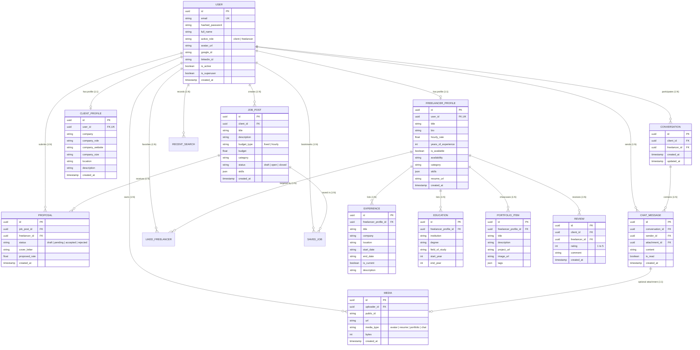

# 🗄️ Database Schema & Relational Data Architecture

> 📝 **What to write in this document:**  
> This document provides the complete data model documentation, entity-relationship diagrams (ERD), table structures, column definitions, data types, and constraint rules of the Skilio platform.  
> - **Evaluator Expectation:** Evaluators will review how your database handles entity relationships, foreign keys, cascade deletions, data integrity, and unique constraints. You must show how data flows between Users, Profiles, Jobs, Proposals, Conversations, and Reviews.  
> - **What you need to complete:**  
>   1. Verify that all tables from your backend models (`backend/app/models.py`) are documented.  
>   2. Check and customize field definitions and data types.  
>   3. Explain the relationship cardinalities (1:1, 1:N, N:M) and cascade delete strategies.

---

## 1. Entity-Relationship Diagram (ERD)

---

## 2. Relational Table Specifications

### 2.1 Core Authentication & User Tables

#### `user` Table
Stores primary user identity, login credentials, role states, and external OAuth IDs.
| Column | Type | Constraints | Description |
| :--- | :--- | :--- | :--- |
| `id` | `UUID` | `PRIMARY KEY, DEFAULT uuid_generate_v4()` | Unique user identifier. |
| `email` | `VARCHAR(255)` | `UNIQUE, NOT NULL, INDEX` | User login email address. |
| `hashed_password` | `VARCHAR(255)` | `NOT NULL` | Argon2/Bcrypt hashed password. |
| `full_name` | `VARCHAR(255)` | `NULLABLE` | Display name. |
| `active_role` | `VARCHAR(50)` | `NOT NULL, DEFAULT 'client'` | Current active workspace (`client` or `freelancer`). |
| `avatar_url` | `VARCHAR(500)` | `NULLABLE` | Cloudinary asset URL for avatar. |
| `google_id` | `VARCHAR(255)` | `NULLABLE, INDEX` | External Google OAuth 2.0 unique ID. |
| `linkedin_id` | `VARCHAR(255)` | `NULLABLE, INDEX` | External LinkedIn OIDC unique ID. |
| `is_active` | `BOOLEAN` | `NOT NULL, DEFAULT TRUE` | Soft-deletion / account active state. |
| `is_superuser` | `BOOLEAN` | `NOT NULL, DEFAULT FALSE` | Administrative role flag. |
| `created_at` | `TIMESTAMPTZ` | `NOT NULL, DEFAULT NOW()` | Account creation timestamp. |

#### `freelancer_profile` Table
Maintains freelancer credentials, rates, skills, and portfolio attachments.
| Column | Type | Constraints | Description |
| :--- | :--- | :--- | :--- |
| `id` | `UUID` | `PRIMARY KEY` | Profile UUID. |
| `user_id` | `UUID` | `UNIQUE, NOT NULL, FK -> user.id (CASCADE)` | 1-to-1 link to user account. |
| `title` | `VARCHAR(255)` | `NULLABLE` | Professional headline (e.g., "Full-Stack Dev"). |
| `bio` | `TEXT` | `NULLABLE` | Self-description and summary. |
| `hourly_rate` | `NUMERIC(10, 2)`| `NULLABLE` | Base billing rate. |
| `years_of_experience`| `INTEGER` | `NULLABLE` | Total experience. |
| `is_available` | `BOOLEAN` | `NOT NULL, DEFAULT TRUE` | Real-time availability badge toggle. |
| `category` | `VARCHAR(100)` | `NULLABLE` | Primary professional category. |
| `skills` | `JSONB` | `DEFAULT '[]'` | Array of tag strings (e.g. `["React", "Python"]`). |
| `resume_url` | `VARCHAR(500)` | `NULLABLE` | Cloudinary PDF resume link. |

#### `client_profile` Table
Stores company background, size, website, and client location.
| Column | Type | Constraints | Description |
| :--- | :--- | :--- | :--- |
| `id` | `UUID` | `PRIMARY KEY` | Profile UUID. |
| `user_id` | `UUID` | `UNIQUE, NOT NULL, FK -> user.id (CASCADE)` | 1-to-1 link to user account. |
| `company` | `VARCHAR(255)` | `NULLABLE` | Company or organization name. |
| `company_role` | `VARCHAR(100)` | `NULLABLE` | Client role (e.g. "CTO", "Founder"). |
| `company_website`| `VARCHAR(255)` | `NULLABLE` | Official company URL. |
| `company_size` | `VARCHAR(50)` | `NULLABLE` | Size category (`solo`, `2-10`, `11-50`, etc.). |
| `location` | `VARCHAR(255)` | `NULLABLE` | Geographical location. |

---

### 2.2 Marketplace & Project Tables

#### `job_post` Table
Contains project listings posted by clients.
| Column | Type | Constraints | Description |
| :--- | :--- | :--- | :--- |
| `id` | `UUID` | `PRIMARY KEY` | Job UUID. |
| `client_id` | `UUID` | `NOT NULL, FK -> user.id (CASCADE)` | User posting the job. |
| `title` | `VARCHAR(255)` | `NOT NULL` | Project title. |
| `description` | `TEXT` | `NOT NULL` | Scope and detailed deliverables. |
| `budget_type` | `VARCHAR(50)` | `NOT NULL` | `'fixed'` or `'hourly'`. |
| `budget` | `NUMERIC(12, 2)`| `NOT NULL` | Project budget amount. |
| `category` | `VARCHAR(100)` | `NOT NULL` | Industry category. |
| `status` | `VARCHAR(50)` | `NOT NULL, DEFAULT 'open'` | `'draft'`, `'open'`, or `'closed'`. |
| `skills` | `JSONB` | `DEFAULT '[]'` | Required skills list. |
| `created_at` | `TIMESTAMPTZ` | `NOT NULL, DEFAULT NOW()` | Posting timestamp. |

#### `proposal` Table
Manages freelancer applications to specific job posts.
| Column | Type | Constraints | Description |
| :--- | :--- | :--- | :--- |
| `id` | `UUID` | `PRIMARY KEY` | Proposal UUID. |
| `job_post_id` | `UUID` | `NOT NULL, FK -> job_post.id (CASCADE)` | Target job listing. |
| `freelancer_id`| `UUID` | `NOT NULL, FK -> user.id (CASCADE)` | Freelancer applicant. |
| `status` | `VARCHAR(50)` | `NOT NULL, DEFAULT 'pending'` | `'draft'`, `'pending'`, `'accepted'`, `'rejected'`. |
| `cover_letter` | `TEXT` | `NOT NULL` | Applicant proposal pitch. |
| `proposed_rate`| `NUMERIC(10, 2)`| `NULLABLE` | Custom proposed budget. |
| `created_at` | `TIMESTAMPTZ` | `NOT NULL, DEFAULT NOW()` | Submission timestamp. |

*Unique Constraint:* `UNIQUE (job_post_id, freelancer_id)` — Prevents multiple proposals by the same freelancer for one job.

---

### 2.3 Real-Time Messaging & Feedback Tables

#### `conversation` Table
Maintains a canonical thread between a client and a freelancer.
| Column | Type | Constraints | Description |
| :--- | :--- | :--- | :--- |
| `id` | `UUID` | `PRIMARY KEY` | Conversation UUID. |
| `client_id` | `UUID` | `NOT NULL, FK -> user.id` | Client participant. |
| `freelancer_id`| `UUID` | `NOT NULL, FK -> user.id` | Freelancer participant. |
| `created_at` | `TIMESTAMPTZ` | `NOT NULL, DEFAULT NOW()` | Thread creation time. |
| `updated_at` | `TIMESTAMPTZ` | `NOT NULL, DEFAULT NOW()` | Last active message time. |

*Unique Constraint:* `UNIQUE (client_id, freelancer_id)` — Ensures a single conversation exists between any two users.

#### `chat_message` Table
Stores individual real-time messages within a conversation.
| Column | Type | Constraints | Description |
| :--- | :--- | :--- | :--- |
| `id` | `UUID` | `PRIMARY KEY` | Message UUID. |
| `conversation_id`| `UUID` | `NOT NULL, FK -> conversation.id (CASCADE)`| Parent conversation thread. |
| `sender_id` | `UUID` | `NOT NULL, FK -> user.id` | Message author. |
| `attachment_id` | `UUID` | `NULLABLE, FK -> media.id` | Attached file or image. |
| `content` | `TEXT` | `NOT NULL` | Message text content. |
| `is_read` | `BOOLEAN` | `NOT NULL, DEFAULT FALSE` | Read receipt tracking. |
| `created_at` | `TIMESTAMPTZ` | `NOT NULL, DEFAULT NOW()` | Sent timestamp. |

#### `review` Table
Handles client-to-freelancer ratings and testimonials.
| Column | Type | Constraints | Description |
| :--- | :--- | :--- | :--- |
| `id` | `UUID` | `PRIMARY KEY` | Review UUID. |
| `client_id` | `UUID` | `NOT NULL, FK -> user.id` | Client reviewer. |
| `freelancer_id`| `UUID` | `NOT NULL, FK -> user.id` | Freelancer receiving review. |
| `rating` | `INTEGER` | `NOT NULL, CHECK (rating >= 1 AND rating <= 5)` | 1-to-5 star rating. |
| `comment` | `TEXT` | `NOT NULL` | Detailed review feedback. |
| `created_at` | `TIMESTAMPTZ` | `NOT NULL, DEFAULT NOW()` | Review timestamp. |

*Unique Constraint:* `UNIQUE (client_id, freelancer_id)` — One review per client-freelancer relationship.

---

## 3. Data Integrity & Cascade Deletion Rules

- **User Cascade:** Deleting a `user` triggers automatic cascade deletions on:
  - Associated `freelancer_profile` and `client_profile`.
  - Owned `job_post` records and submitted `proposal` records.
  - Authored `chat_message` records.
  - Linked `liked_freelancer` and `saved_job` bookmark records.
- **Job Cascade:** Deleting a `job_post` automatically deletes all submitted `proposal` records and `saved_job` bookmarks for that post.
- **Conversation Cascade:** Deleting a `conversation` deletes all contained `chat_message` records.
