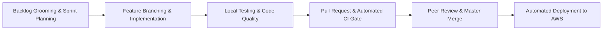

# 📋 Project Management & Team Collaboration

> 📝 **What to write in this document:**  
> This document details the software development lifecycle, organizational methodologies, collaboration tools, and communication channels adopted by the team throughout the project.  
> - **Evaluator Expectation:** Evaluators evaluate whether your team worked as a coordinated unit or merely combined disparate code at the end. Demonstrating structured task distribution, disciplined version control, regular syncs, and fast blocker resolution is essential for full marks.  
> - **What you need to complete:**  
>   1. Review the workflow stages below and describe your actual team routines (e.g., daily standup times, sprint duration).  
>   2. List the specific project management tools used (e.g., GitHub Projects link, Trello board, Notion workspace).  
>   3. Detail the communication channels and cadence (Discord server channels, Slack workspaces, WhatsApp group).  
>   4. Include sample meeting logs or sprint retrospectives to prove consistent team coordination.

---

## 1. Project Management Methodology

The team adopted an **Agile-inspired Scrum/Kanban workflow** tailored to the fast-paced delivery schedule of 42 curriculum projects. Work was divided into iterative milestones, prioritizing core system architecture before implementing user-facing features.

### 1.1 Sprint Organization & Milestones

| Milestone / Sprint | Focus Area | Deliverables |
| :--- | :--- | :--- |
| **Sprint 1: System Inception & Infra** | DevOps & Architecture | Monorepo structure, Docker Compose setup, PostgreSQL + Redis containers, FastAPI skeleton, React + Vite skeleton, CI pipeline. |
| **Sprint 2: Core Domain & Data Layer** | Backend & Database | SQLModel schema definitions, Alembic migrations, CRUD services, JWT & OAuth authentication flow, seed script. |
| **Sprint 3: Real-Time & Workflows** | Messaging & Job Lifecycle | WebSocket server, Redis Pub/Sub event bus, dual-role workspace switching, job postings, proposals engine. |
| **Sprint 4: Frontend Polish & UI/UX** | Client Interface | React 19 UI, Tailwind v4 styling, shadcn/ui components, search filters, mobile responsiveness, profile pages. |
| **Sprint 5: Production & Resilience** | DevOps & Hardening | AWS EC2 provisioning, Traefik reverse proxy, Let's Encrypt TLS, backup daemon, DR test drill, Prometheus/Grafana. |
| **Sprint 6: Final QA & 42 Defense Prep**| Testing & Documentation | Bug fixes, input validation tests, end-to-end rehearsal, evaluation documentation, master presentation slides. |

---

## 2. Tools & Infrastructure

> 📝 **What to customize:** Confirm the exact URLs or names of the boards and tools your team utilized.

### 2.1 Task Tracking & Kanban
- **Primary Tool:** **GitHub Issues & GitHub Projects** (Kanban Board)
  - Columns: `Backlog`, `Ready for Dev`, `In Progress`, `Under Review (PR)`, `Testing/QA`, `Done`.
  - Issue Labels: `bug`, `feature`, `enhancement`, `devops`, `frontend`, `backend`, `documentation`, `p1-blocker`.
  - Every pull request was explicitly linked to an issue (e.g., `Closes #42`).
- *(Optional alternative used: Trello / Notion board)*: `[Insert link or screenshot if applicable]`

### 2.2 Version Control & Code Quality
- **Platform:** GitHub Organization / Repository: `https://github.com/Moody-0x01/Freelancer`
- **Branching Strategy:** Lightweight GitHub Flow.
  - Active personal and feature branches (`aysadeq`, `amine`, `Hossin`, `osama`, `zakaria`, `feat/*`).
  - Direct pushes to `master` strictly forbidden via branch protection rules.
  - Pull Requests require passing GitHub Actions CI gates before merging.
- **Detailed Git Guidelines:** See [docs/git-workflow.md](./git-workflow.md) for full branch and merge conventions.

### 2.3 Automated CI/CD Testing Gate
Every Pull Request triggers automated GitHub Actions checks:
1. **`test-backend`**: Runs pytest test suite (170+ tests) across endpoints, auth, and CRUD operations.
2. **`lint`**: Executes Ruff for Python formatting and linting; Biome for frontend TypeScript validation.
3. **`test-docker-compose`**: Validates container image builds and service health checks.

---

## 3. Communication Channels & Cadence

Effective team communication was maintained through real-time text channels, voice syncs, and on-campus co-working sessions at 42.

| Channel | Platform | Purpose | Cadence |
| :--- | :--- | :--- | :--- |
| **Daily Standups** | Discord Voice / 42 Cluster | 15-minute sync: What did you do yesterday? What are you doing today? Are there any blockers? | Daily (Mon–Fri) at 11:00 AM |
| **Development Chat** | Discord (`#dev-backend`, `#dev-frontend`, `#devops`) | Asynchronous coordination, sharing API schema updates, debugging code snippets. | Continuous / Real-time |
| **General & Announcements**| Discord (`#general`) | Major milestone announcements, schedule changes, deployment notifications. | As needed |
| **Urgent Escalations** | WhatsApp / Phone | Immediate notification of server outages, critical blockers, or meeting reminders. | Urgent only |
| **Architecture Reviews** | In-person at 42 Campus | Whiteboarding database schemas, entity relationships, and module evaluation strategy. | Weekly (Saturdays) |

---

## 4. Team Meeting Logs & Minutes (Template)

> 📝 **What to complete:** Keep a log of key team decisions below to illustrate consistent collaboration to evaluators.

### Meeting 1: Project Kickoff & Architecture Alignment
- **Date:** `[YYYY-MM-DD]`
- **Attendees:** `<aysadeq>`, `<arajma>`, `<lazmoud>`, `<omorakwant>`, `<zbakour>`
- **Agenda:** Project scope definition, selecting technology stack (FastAPI + React 19 + PostgreSQL), and dividing primary leadership roles.
- **Decisions Made:**
  - Selected PostgreSQL over SQLite/MongoDB for robust relational consistency and ACID guarantees.
  - Decided on a unified account model with on-demand dual-role switching (`client` / `freelancer`).
  - Assigned `<aysadeq>` as DevOps Lead, `<arajma>` as Backend Lead, `<omorakwant>` as Frontend Lead, `<lazmoud>` for Real-time, `<zbakour>` as Product Owner.

### Meeting 2: Mid-Sprint Sync & Integration Review
- **Date:** `[YYYY-MM-DD]`
- **Attendees:** `<aysadeq>`, `<arajma>`, `<lazmoud>`, `<omorakwant>`, `<zbakour>`
- **Agenda:** Review OpenAPI TypeScript client generation, WebSocket handshake flow, and staging environment on AWS.
- **Decisions Made:**
  - Standardized on `Hey-API` to auto-generate the TypeScript SDK directly from backend schemas (`scripts/generate-client.sh`).
  - Added Redis Pub/Sub fallback to in-memory dispatch to facilitate offline local development without requiring Redis.

### Meeting 3: Final Pre-Defense Evaluation Dry Run
- **Date:** `[YYYY-MM-DD]`
- **Attendees:** All members
- **Agenda:** End-to-end evaluation simulation, peer testing on Google Chrome, disaster recovery drill rehearsal (`make dr-test`).
- **Decisions Made:**
  - Confirmed zero console errors on Chrome.
  - Rehearsed the 6-phase evaluation presentation order.
